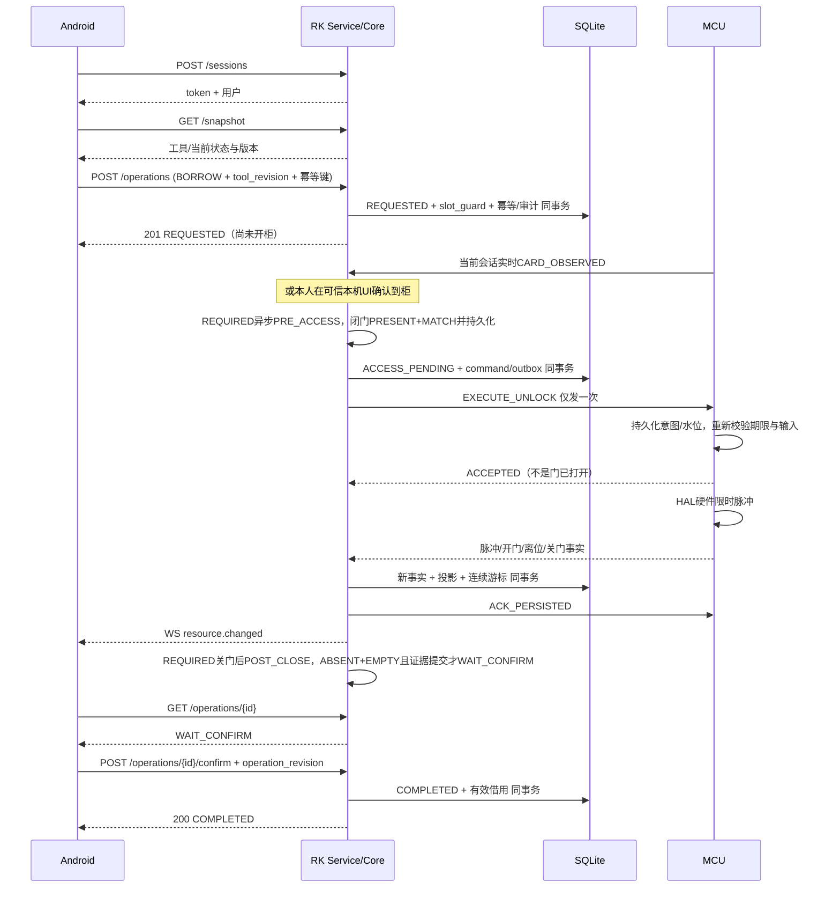

# API 链接与内部调用链

版本：0.2.1设计，尚无服务器。[分阶段调用链](stage-call-chains.md)、[接口归属](traceability.md)、[视觉参数与地址](vision-interfaces.md)分别定义接线和实施。

## 1. 地址、传输与身份

| 使用方 | 地址 | 能力 |
|---|---|---|
| Android | `https://<终端局域网地址>:8443/api/v1` | 登录、查询、申请/确认/取消、按权限管理 |
| Android WS | `wss://<终端局域网地址>:8443/api/v1/ws` | 仅变化提示；连接后查询权威快照 |
| LVGL | `/run/locker/service.sock`，AF_UNIX SOCK_SEQPACKET | 同一Core命令、已登录用户的柜前确认 |
| 本机管理员CLI | 同一受限service.sock，独立管理员peer与会话校验 | 初始化/维护核对；无远程GPIO/强制开锁 |
| 进程监督 | `/run/locker/supervisor.sock` | 真实进度报告、只读health.get和固定UI恢复 |
| RK到MCU | 独立控制UART，115200 8N1，wire v1 | 快照、事实补取、关联动作、状态查询、健康与时间锚点 |
| Core到视觉worker | /run/locker/vision.sock，独立SOCK_SEQPACKET | HELLO/STATUS/CAPTURE，有界元数据，不接图片路径或上传 |
| Android视觉读取 | /api/v1/vision/status、/api/v1/operations/{operation_id}/vision | 鉴权只读状态/本人或ADMIN证据，GET不拍照 |

局域网地址通过柜体配置/配对信息提供；阶段1示例为主机回环地址，不能把手机自身127.0.0.1当终端。部署时可给终端固定DHCP租约，不默认实现mDNS、蓝牙发现或云端穿透。更换地址/证书需要重新核对信任，不接受任意证书。

外部Bearer token决定用户身份，客户端没有actor_id/source/principal赋值权。RPC的本机身份由SO_PEERCRED和部署权限决定，不来自JSON。外部request_id只排障，Core内部submission_token匹配完成结果；操作幂等另用Idempotency-Key。

## 2. 一次借出的接口时序

归还复用同一流程，kind=RETURN，物品离位→在位且关闭原借用。普通申请阶段没有outbox；只有可信柜前证明通过后才创建一次物理command。

## 3. 对外入口到内部函数

| API / 事件 | 适配与核心入口 | 仓储/设备端口 | 完成的含义 |
|---|---|---|---|
| POST /sessions | HTTP→SESSION_CREATE→Core | repo_query用户/索引，密码库校验，repo_commit_change会话 | 登录成功，不产生硬件动作 |
| GET /snapshot、/tools、/loans、/events | HTTP→core_query队列包装 | Core一致副本或repo_query分页 | 有权限的读取，最多等1000ms |
| POST /operations | core_submit OPERATION_CREATE→wait_result(submission_token) | repo_commit_change占位/申请/幂等 | 201只表示申请落库 |
| 私有presence.submit / 实时卡事件 | 已核验peer/owner或live卡→Core | repo_commit_change动作意图→device_execute_once | 产生一次command，尚无开门事实 |
| EXECUTE响应 | device_bind_sink→core_apply_device_reply | 查询/匹配session、request_no与command | ACK与真实动作分开 |
| DEVICE_EVENT | device_bind_sink→core_apply_device_event | repo_import_events(batch,projection_change)→ack_persisted | 只导入新事实；历史/重复事件不开柜 |
| POST confirm/cancel/resolve | Core权限、版本与状态机 | repo_commit_change | 确认/取消/核验的明确状态，不绕过物理证据 |
| GET/POST/PATCH users、绑定卡 | 同一Core命令映射 | repo_query/commit_change | 管理员权限，唯一索引与审计同事务 |
| 实时进度 / UI恢复 | 私有supervisor RPC | 固定UI目标、限次检查点 | 接受恢复请求不等于恢复完成 |
| 监督健康读取 | Runtime→health.get→locker_supervisor_get_health | core_apply_supervisor_health入队/DevicePort组装HOST_HEALTH | 原样本老化；Core唯一更新Device投影 |
| 本机maintenance.reconcile | 管理员CLI peer + ADMIN会话→Core | 当前账本/实物比较、审计、必要RESUME_READY | 不开锁、不改历史；有未决操作先走resolve |
| 视觉采集/结果 | 持久capture→vision_submit→worker→sink→core_apply_vision_result | 原请求/策略/结果/融合与操作同事务 | guard/实例/时间复核后才参与决策 |
| 视觉两条GET | core_query VISION_STATUS_GET/VISION_EVIDENCE_LIST | Core投影/operation前缀分页 | 无NPU副作用，无图像/本机路径 |

完整的24个公开入口及字段见[公开API速查](public-api.md)和[OpenAPI](../../contracts/openapi.json)。内部C函数见[内部接口](internal-interfaces.md)；参数/返回、异步完成、构造销毁和回调生命周期均属于契约。

## 4. 不能走错的链接

- 手机不能直接连MCU执行开锁，也不能调用本机presence/maintenance方法。
- 本机UI不直接读写SQLite或GPIO；不能把超时当成取消成功。
- MCU读到一张卡不等于有借用权限，UID事件由RK匹配当前申请人。
- 断线后先新session、快照屏障、补取落库、核对、CAS放行，不把旧outbox重新发一遍。
- 锁尾杆手动开门或无指令的物品变化保留事实并进入hold；维护核对只允许本机管理员，不能由手机“确认成功”抹掉。
- HAL句柄、板卡引脚和NO/NC极性只在BSP/profile适配，不能出现在Android请求或公开API参数中。

## 5. 后续AI的接线顺序

先执行[阶段1任务卡](../stages/stage-01-task-cards.md)：T01基础类型/生命周期→T02仓储和T03模拟器→T04 Core→T05 HTTP/IPC→T06装配→T07集成审计。所有端使用同一契约，不另建手机后端或第二套账本。

随后执行[阶段2 HAL硬件任务卡](../stages/stage-02-hal-hardware-task-cards.md)。本地HAL V1.8.5已有所需API，具体工程/时钟/IRQ调整留在该任务，不妨碍阶段1主机设计与开发。

S2-08后执行[2B视觉八卡](../stages/stage-02b-vision-task-cards.md)，S2-16为完整门禁。REQUIRED借出前PRESENT+MATCH、取走关门后ABSENT+EMPTY；归还前ABSENT+EMPTY、放入关门后PRESENT+MATCH。后续AI见[接线说明](vision-ai-handoff.md)。

再按[阶段3客户端](../stages/stage-03-clients-task-cards.md)→[阶段4独立监护](../stages/stage-04-monitoring-task-cards.md)→[阶段5部署交付](../stages/stage-05-delivery-task-cards.md)逐卡推进；执行[单卡交接](../stages/task-handoff-template.md)，不一次展开所有功能。
