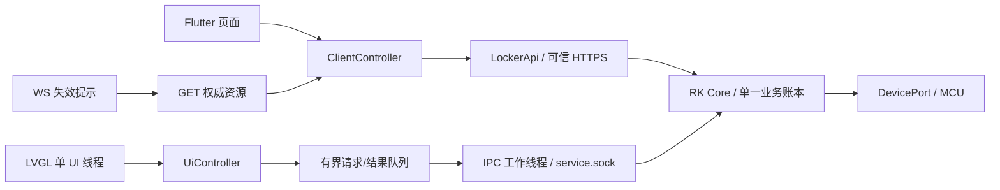
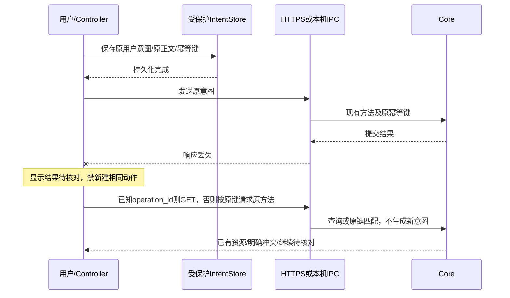

# Android 与触摸终端接口设计

状态：阶段 3 设计交接，尚未实现或运行验收。范围为同一局域网的一柜格、一件固定工具和 Android Flutter App。本文补充客户端内部接口，不增加公开路由、UART 消息或借还状态。

执行卡见[阶段 3 任务卡](../stages/stage-03-clients-task-cards.md)。跨端字段以 [OpenAPI](../../contracts/openapi.json)、[根契约](../../contracts/contract-source.json)和[私有 RPC 真源](../../contracts/internal-data-source.json)为准。

## 1. 两端共享什么



两端复用相同字段、权限和核心状态机，不共用可变内存、不复制业务判断。App 无柜前证明接口；LVGL 只通过可信本机 `presence.submit` 证明当前已登录本人到柜。管理员日常核验走 `resolveOperation`；`maintenance.reconcile` 只属于本机管理员 CLI，不添加到手机或触摸界面。

契约0.2.1保持24个公开入口与11类UART请求。`Device.ui_restart_count`允许null，客户端显示“未知”，不能替换成0；Core通过supervisor.sock的`health.get`镜像监督信息，客户端不自行估计恢复次数。该监督私有方法由服务/监督层集成，不增加手机网络能力。

界面根据服务端 `allowed_actions`、当前登录用户和连接是否已重查决定按钮；服务端仍逐次鉴权、比较版本和核对物理事实。客户端不能凭按钮状态授予权限。

视觉读取getVisionStatus和当前getOperationVisionEvidence，合并到原刷新器，不逐widget轮询。WS仍只用device/operation提示后GET重查；显示模式/检查中/MATCH/EMPTY/待人工，EMPTY不能显示已还。页面不提交图片、阈值、采集请求，也不以分类成功替本人confirm。

## 2. 模型、错误与请求上下文

| 客户端私有类型 | 字段与规则 |
|---|---|
| `U64Text` | 经完整 uint64 上界校验的十进制文本；Dart 比较用 `BigInt`，C 使用 `uint64_t`；不经浮点或有符号 64 位溢出转换 |
| `CallContext` | 新的 `requestId: UUID`、本地请求截止、可选 `intentId: UUID`；requestId 只关联一次传输，不代表用户意图 |
| `ApiResult<T>` | `Success<T>(data, snapshotRevision, requestId)` / `ServerError(code, retryable, operationId?, requestId)` / `TransportFailure(kind, mayHaveCommitted)`；204 专用无正文结果 |
| `ConnectionState` | 客户端本地 `unpaired / signedOut / syncing / online / offline / trustBlocked`；这些值不写到服务器 `DeviceMode` |
| `MutationIntent` | 原用户ID、配对设备ID、operationId或目标路径、操作ID、不含秘密的规范化正文/查询、同一个幂等键、创建时间、待核对状态；先持久化再发送。含密码请求仅保存非敏感定位，见第6节例外 |
| `ScreenState` | 当前用户、只读权威快照、资源版本、待核对意图、连接状态和最后成功查询时间；不是第二套账本 |

客户端严格解析已知 schema，未知操作状态/动作/关键字段非法时进入只读错误页并要求同步契约；不得把未知值当 `READY`、`false` 或成功。页面只展示服务端提供的本人/管理员可见数据，不缓存完整其他用户事件。

429/503 的 `retryable=true` 只准有界查询或重试原意图。409 先 GET 最新资源并展示冲突；旧幂等键绑定旧正文，不能换版本后仍冒用旧键。用户再次阅读最新资源并明确提交，才是新的意图。401 清当前会话并重新登录；403 保留只读上下文、关闭越权入口；TLS 错误为 `trustBlocked`，不循环重试登录。

## 3. Android 内部接口

以下为要实现的签名规格，不是现有代码。`Future` 完成仅表示对应结果，不保证服务器因本地取消而停止。一个柜体只创建一套连接上下文；首版使用 Flutter 自带 `ChangeNotifier`/不可变状态，避免引入第二套状态机框架。

```dart
abstract interface class PairingStore {
  Future<PairingCandidate> inspectPublicBundle(Uint8List jsonBytes);
  Future<TrustedCabinet> accept(PairingCandidate c, CabinetComparison comparison);
  Future<TrustedCabinet?> load();
  Future<void> forget();
}
abstract interface class CredentialStore {
  Future<void> save(String deviceId, Session session);
  Future<StoredSession?> load(String deviceId);
  Future<void> clear(String deviceId);
}
abstract interface class IntentStore {
  Future<void> saveBeforeSend(MutationIntent intent);
  Future<List<MutationIntent>> pendingFor(String deviceId, String userId);
  Future<void> markResolved(String intentId, IntentResolution resolution);
}
abstract interface class LockerApi {
  Future<void> open(TrustedCabinet cabinet);
  Future<ApiResult<T>> call<T>(ApiCall<T> call, CallContext context);
  Stream<ChangeHint> watchChanges();
  Future<void> setForeground(bool foreground);
  Future<void> close();
}
abstract interface class ClientController {
  Future<void> start();
  Future<void> login(String username, String password);
  Future<void> refresh(RefreshScope scope);
  Future<void> beginBorrowOrReturn(CreateOperationRequest request);
  Future<void> confirm(Operation current);
  Future<void> cancel(Operation current, String reason);
  Future<void> resolve(Operation current, ResolveRequest request);
  Future<void> reconcilePending(String intentId);
  Future<void> logout();
  Future<void> disposeAsync();
}
```

`ApiCall<T>` 是白名单操作描述符，操作ID与输入/输出类型按第 4 节固定。没有任意 URL、动态 HTTP 方法、任意 JSON 补字段或自动重试拦截器。管理页面也只用 `LockerApi.call` 中的已声明方法；`ClientController` 不暴露原始网络对象。

`open` 载入已核对证书并建立专用 HTTP 客户端；成功后才允许 `login`。`watchChanges` 在当前会话存在时建立 WSS，只有一个订阅，终止后关闭 socket；重建订阅不重放 mutation。`close` 先拒绝新请求，再撤销本地订阅、关闭连接并等待回调退出；未收到响应的 mutation 标为待核对。`disposeAsync` 从页面外生命周期统一等待，完成后不会继续通知已销毁对象。

所有 Flutter 页面更新在主 isolate 进行。网络异步完成先检查 controller generation、设备ID和当前用户，丢弃旧页面/旧登录的响应。刷新合并为最多一个在途快照查询和一个 dirty 标记；不能由每个 widget 启动自己的轮询。网络层不在回调中修改组件对象，密码只在当前提交的短期变量内使用并尽早释放引用。

## 4. 服务操作映射

Android `ApiCall` 名称与 OpenAPI `operationId` 一致；LVGL 使用表中 RPC `method`。路径均相对 `/api/v1`。表中“同名”表示与第一列完全一致，不允许自行起另一套远端方法名。

| 方法名 | Android HTTPS / WSS | LVGL RPC method | 类型与作用 |
|---|---|---|---|
| `login` | POST `/sessions` | 同名 | LoginRequest → Session |
| `getCurrentSession` | GET `/sessions/current` | 同名 | User；恢复时重新验证会话 |
| `logout` | DELETE `/sessions/current` | 同名 | 204；不取消借还 |
| `getDevice` | GET `/device` | 同名 | Device；检查设备ID、契约和 simulated |
| `getSnapshot` | GET `/snapshot` | 同名 | Snapshot；权威总览 |
| `listTools` | GET `/tools` | 同名 | ToolList |
| `getTool` | GET `/tools/{tool_id}` | 同名 | Tool |
| `createOperation` | POST `/operations` | 同名 | CreateOperationRequest → Operation；必须幂等键 |
| `getOperation` | GET `/operations/{operation_id}` | 同名 | Operation；结果核对 |
| `getVisionStatus` | GET `/vision/status` | 同名 | VisionStatus，模式/相机/模型状态，只读 |
| `getOperationVisionEvidence` | GET `/operations/{operation_id}/vision` | 同名 | VisionEvidencePage，本人/ADMIN证据，无图片/路径/采集副作用 |
| `confirmOperation` | POST `/operations/{operation_id}/confirm` | 同名 | RevisionRequest → Operation；必须幂等键 |
| `cancelOperation` | POST `/operations/{operation_id}/cancel` | 同名 | CancelRequest → Operation；必须幂等键 |
| `listLoans` | GET `/loans` | 同名 | LoanPage；不透明cursor、limit |
| `listEvents` | GET `/events` | 同名 | EventPage；cursor、limit、可选operation_id |
| `listReviews` | GET `/reviews` | 同名 | ReviewList；ADMIN |
| `resolveOperation` | POST `/operations/{operation_id}/resolve` | 同名 | ResolveRequest → Operation；ADMIN、幂等键 |
| `listUsers` | GET `/users` | 同名 | UserList；ADMIN |
| `createUser` | POST `/users` | 同名 | CreateUserRequest → User；ADMIN、幂等键 |
| `updateUser` | PATCH `/users/{user_id}` | 同名 | PatchUserRequest → User；ADMIN、user_revision、幂等键 |
| `listCardObservations` | GET `/card-observations` | 同名 | CardObservationList；ADMIN、短期实测观察 |
| `bindCard` | PUT `/users/{user_id}/card` | 同名 | BindCardRequest → CardBinding；ADMIN、幂等键 |
| `unbindCard` | DELETE `/users/{user_id}/card?user_revision=…` | 同名 | CardBinding；ADMIN、查询版本、幂等键 |
| `subscribeChanges` | GET `/ws`，升级 WSS | 不提供 | 只接收变化提示，Bearer 在请求头 |
| 本机到柜证明 | 不提供 | `presence.submit` | LocalPresenceRequest → Operation；owner会话+可信UI peer+幂等键 |
| UI真实进度 | 不提供 | `progress.report`，supervisor.sock | ProgressReport → SupervisorRpcAck；实例与peer绑定，保留源sampled_mono_ms |

公开和同名私有方法随后统一进入既有 Core command/query 绑定。借还写操作进入 `locker_core_submit → locker_core_wait_result → locker_repo_commit_change`；柜前证明通过才允许既有 `locker_device_execute_once`。查询进入 `locker_core_query`。界面不能直接访问 Repository、DevicePort、HAL 或 UART。

## 5. 配对、TLS 与凭据

首版采用**本机管理员导出公开配对文件、手机导入并柜前核对**，不依赖新发现协议、摄像头、云端或额外硬件。文件是本地配置交换格式，不是公开 API 请求。

配对文件只含 `format_version=1`、`https_base_url`、`device_id`、`certificate_der_base64`、`certificate_sha256`。上限 8192 字节，严格字段校验；DER 大小不超过 4096 字节；不含密码、session token、私钥、客户端授权或 GPIO。URL 只允许 `https://<固定主机>:8443/api/v1`，无用户名/密码/查询/片段。设备ID使用现有24位小写十六进制规则，指纹为叶证书 DER 的完整 SHA-256。公开材料由S2-06现场网络准备的本机受限工具导出；S3-02实际配对前必须可用，阶段5只固化部署手册，不能推迟首次配对所需工具。不开匿名 `/pair` HTTP 入口。

1. 柜体本地显示或管理员贴签提供 HTTPS 地址、设备ID、完整指纹；管理员从柜体读取并导出公开证书。导入文件的SHA字段不能自证可信。
2. 手机重新计算 DER 指纹，用户在柜前逐项核对完整指纹、地址与设备ID；只看相同后四位不合格。未确认时不发送登录密码或 token。
3. 每柜部署专用证书；使用导入证书建立 `SecurityContext(withTrustedRoots: false)`，只加入该柜信任材料，不回退系统证书库；默认拒绝不可信证书，保持有效期、证书链和主机名检查。证书 SAN 必须覆盖配对地址。首版为该柜独立自签证书，不信任可签发任意其他设备的共享 CA。
4. HTTPS 与 WSS 共用该上下文与固定 origin；禁止跟随跨origin重定向，首版直接拒绝所有3xx。严禁 `HttpOverrides` 全局放行、`badCertificateCallback => true`、明文HTTP回退或把token放URL。实际 Dart TLS 行为要按 S3-02 测试叶证书、SAN、日期及替换拒绝；不通过则停止连接，不降低验证。
5. 登录后 `getDevice` 必须与柜前设备ID一致，契约版本兼容且 `simulated=false` 才进入实物模式。测试设备的 simulated 标志必须明显显示。验证失败退出会话并阻断动作。
6. 证书变更、证书过期、地址变更或设备身份不符时冻结请求、清理旧连接与本地会话，重新柜前配对；不从网络弹窗一键“永久信任”。账号尚有借还记录不因此取消。忘记配对清本机连接材料，不发送业务取消。

Android 只申请 `INTERNET` 等目标SDK实际必需权限；首版文件导入用系统文档选择器，不申请全盘存储/蓝牙/定位/摄像头。若目标Android对局域网访问另有要求，S3-01按实际targetSdk核对并记录，不凭旧模板添加多余权限。

token 使用 Keystore 支撑的安全存储，以device_id命名隔离，排除Android备份；密码不保存。持久意图只含非敏感借还目标/正文或创建账号的定位字段，放同样受保护的私有存储；login/createUser的密码绝不进入IntentStore、日志、抓包证据或备份，不缓存敏感用户表/原始卡UID。凭据读取失败或Keystore恢复失败进入重新登录，不能回退明文配置。8小时服务端会话为权威，手机本地到期判断只提前隐藏入口。启动/回前台先 `getCurrentSession → getDevice → getSnapshot`，成功后才显示可提交状态。

退出先尽力撤销服务器会话，随后无论网络是否可用都清本地token；离线退出必须明确服务器会话可能直到过期才失效。未决意图仍按原设备与原用户受保护保存，其他登录用户不可读取或重试；原用户再登录后可回查。不能因退出清除未决事实并默认“没有操作”。

## 6. 幂等与结果不确定的调用链



契约要求幂等的业务写操作，每次明确用户点击只生成一个幂等键，重复点击复用在途意图；先保存非秘密意图成功再发网络。`RESULT_PENDING`、请求超时、socket关闭、App被杀、页面销毁都不能证明没有提交。已知operation_id先GET；创建操作响应丢失且未知ID时，用户在重新鉴权后点击“核对结果”，才用原键与完全相同正文调用 `createOperation`。不能添加不存在的幂等查询路由。

含密码请求例外：`login`不写MutationIntent、不使用业务幂等键，密码只在当前登录提交的短期内存中。`createUser`必须保留原幂等键，但持久意图只保存设备/管理员身份、username、display_name、role等非敏感定位与请求元数据，绝不保存密码、密码可恢复密文或密码派生值。原请求正文只在当前提交的短期内存内，使用后尽早释放引用。丢响应后先用ADMIN `listUsers`按唯一username核对当前账号及非敏感属性，不自动创建第二个账号；属性冲突交管理员核查，不覆盖已有账号。若仍需原键重发而密码已丢失，用户必须重新输入原密码后重建完全相同正文；原键与正文不符得到IDEMPOTENCY_CONFLICT时停止并核查，不能自动换键重建或记录密码排错。App或柜屏崩溃后不能从持久意图自动恢复该密码请求。

副作用请求一律不由连接重试器、WS重连或后台任务自动重放。确认/取消/核验通过GET核对已有状态，必要时复用原键获取原结果；新的版本重试必须用户重新阅读后明确提交。UI离线可看标记为过期的既有内容，不能排队离线借还。意图早于服务器30天保留窗口且未核对时停止重发，交本机管理员核查历史，不能换新键假装首次申请。

`presence.submit` 更严格：本机IPC断线后只查 `getOperation`，不自动补发到柜证明；用户在当前柜前界面重新确认且拿到最新版本时才可产生新的明确意图。可能已有command时界面只展示查询/核验，不能再产生开锁意图。

## 7. WS、前后台与版本

WS只接受现有 `resource.changed` / `resync_required`，不携带借还命令、不替代事件分页。握手Bearer只在头部，握手失败/401按会话规则处理。首次连接、重连、溢出、解析失败、收到resync一律GET权威快照；resource.changed合并为dirty标记并查询相关资源。不能收到“operation变化”就本地推进到COMPLETED。

前台每10秒刷新快照兜底，WS提示可提前刷新；后台停止轮询并关闭WS，不在后台排队写操作。返回前台重新验证会话与设备并取快照；重连使用1/2/4/8/16/30秒有上限退避，前台定时器只发只读请求。连续失败进入offline、保留待核对标记；不假装设备Offline枚举已由服务器确认。

同一会话内只采纳不旧于已采纳资源版本的结果；比较使用对应revision，不能用tool_revision替代operation_revision。刷新响应必须属于同一个登录generation；不能把不同GET的字段拼成同一原子快照。倒计时只是提示，本地归零后重查，不自行取消、成功或释放占位。

## 8. LVGL 内部接口、线程与生命周期

触摸程序独立于业务服务，只连固定部署路径service.sock和supervisor.sock。UI线程独占全部控件与 `lv_timer_handler()`；IPC线程只收发、验证和复制消息，不调用 `lv_…`，不把request栈或解析树指针交给UI。选择适合现有RK BSP的LVGL主版本并锁定，不能混抄8/9控件API。

下列 `ui_` 类型均为terminal-ui私有类型，不写入公共C契约头。`ui_rpc_call_t` 包含现有InternalRpcRequest的类型化字段，使用method白名单；`ui_rpc_result_t` 保留status、公共响应类型和request_id。

```c
ui_status_t ui_ipc_create(const ui_ipc_config_t *cfg, ui_ipc_t **out);
ui_status_t ui_ipc_start(ui_ipc_t *ipc);
ui_status_t ui_ipc_submit(ui_ipc_t *ipc, const ui_rpc_call_t *call,
                          uint32_t timeout_ms, ui_request_handle_t *out);
ui_status_t ui_ipc_try_take(ui_ipc_t *ipc, ui_rpc_result_t *out);
void ui_rpc_result_release(ui_rpc_result_t *result);
void ui_ipc_stop(ui_ipc_t *ipc);
void ui_ipc_destroy(ui_ipc_t *ipc);

ui_status_t ui_controller_create(const ui_controller_config_t *cfg,
                                 ui_ipc_t *ipc, ui_controller_t **out);
ui_status_t ui_controller_dispatch(ui_controller_t *ui, const ui_action_t *action);
void ui_controller_step(ui_controller_t *ui, uint64_t now_ms);
void ui_controller_commit_loop_progress(ui_controller_t *ui,
                                        uint64_t completed_mono_ms);
bool ui_controller_copy_progress(const ui_controller_t *ui,
                                 ui_progress_sample_t *out);
void ui_controller_destroy(ui_controller_t *ui);
```

`create`复制配置且不启动线程；`start`失败保持可销毁状态。`submit`在UI线程调用，不等待服务结果，复制完整请求到队列，排队成功只返回本地handle；队列满返回LOCAL_BUSY且不发送。默认最多8个在途、请求队列16、结果队列16，控制器每次只保留一个mutation在途；上限是客户端私有约束，不放宽Core队列。`try_take`非阻塞且结果所有权交UI，必须release一次；全量结果若队列满不得静默丢mutation，标记连接需核对并保留原意图。只读刷新可合并为dirty。

IPC使用 `AF_UNIX SOCK_SEQPACKET`，每包一个严格UTF-8 JSON。请求≤8192字节，响应≤65535字节；recvmsg遇MSG_TRUNC不得解析部分JSON，清连接并把已发mutation标待核对。request_id仅匹配当前连接generation；不认识/重复/旧连接响应不覆盖当前页面。timeout结束等待不代表取消Core命令。发送失败若无法证明零字节被接受，同样按待核对处理。session_token只在内存，LVGL重启回登录页，不保存共享终端账号密码或长期登录token。

新UI进程创建新instance_id，progress从0开始；0表示本实例尚未完成真实UI主循环，不能作为恢复完成证据。初始化的0样本带创建时的sampled_mono_ms，复制/发送0不得刷新该源采样。登录页完成更新、输入处理与lv_timer_handler的一整轮即可产生非零进度，不等待登录或getSnapshot；此进度只证明界面循环可交互，不证明业务已经同步。

UI线程每轮执行 `ui_controller_step`：消费有界结果批次→更新只读视图→处理输入→完成 `lv_timer_handler()`；完整一轮返回后，只在该UI线程调用一次 `ui_controller_commit_loop_progress(ui, CLOCK_MONOTONIC当前毫秒)`。该方法首次产生1，此后按实际完整回路递增，并同时记录 `sampled_mono_ms`。两字段在同一受保护临界区生成不可变观测。`ui_progress_sample_t`包含 `uint64_t progress` 与 `uint64_t sampled_mono_ms`；前者只由真实完整循环递增，后者只在生成该新计数时写入。

`ui_controller_copy_progress`只复制源观测，不接受“当前时间”参数，不增加计数或刷新sampled_mono_ms。IPC工作线程每秒发送最近sample，ProgressReport包含target、instance_id、progress、sampled_mono_ms、observed_age_ms；两个u64为十进制字符串。observed_age_ms表示源采样时已有的年龄，真实循环刚完成的新样本为0；没有有效非零进度时为UINT32_MAX。发送时不把now-source_sample填回该字段，否则接收方再累计会重复计算。排队/序列化/重试/搬运保留源时间与源年龄，接收者用饱和加(source_age, now-source_sample)覆盖全部排队时间。同counter不刷新最后真实进展；未来/倒退/异时钟样本无效，跨线程取受保护副本。

例如真实循环在120000ms生成progress="42"、sampled_mono_ms="120000"、observed_age_ms=0；IPC在120350ms发送仍保留这三项。125500ms接收时有效年龄为5500ms；不能填350后再累加5500。继续上报42不能续命，ACK只证明收包。

阶段3只实现进度生产与RPC客户端；独立supervisor及恢复在阶段4验收。supervisor不存在时显示观察通道不可用，不伪造ACK或健康；UI/supervisor缺席只告警并使自动恢复不可用，不单独阻断阶段2先于本阶段运行。主机允许新动作的健康资格依据真实Core循环新鲜度，其他既有会话/物理/存储/版本条件仍须成立；不能把UI线程或监督报告活着当作Core健康。`progress.report`中的instance_id为每次UI进程新UUID；registered peer绑定由阶段4服务端核验。

supervisor只有看见期望的新instance绑定成功，且其非零progress至少出现两次严格递增、源样本均新鲜，才认定OBSERVED_RUNNING；单次非零、0、旧实例或相同counter重发都不够。OBSERVED_RUNNING只证明UI恢复可交互，不证明登录、业务快照或设备READY。登录页可满足UI恢复观察，不能因未登录而反复重启UI。本协议没有增加“已启动”替代RPC。LVGL重启清token回登录页，业务按钮仍须用户重新登录、设备/契约校验及fresh snapshot成功后按allowed_actions启用；不保存旧token或增加匿名getSnapshot。UI恢复观察与业务同步分开，不相互等待。

停止顺序：停止接受UI输入→标记在途副作用需核对→`ui_ipc_stop`关闭fd并join线程→消费/释放剩余结果→销毁controller和控件→destroy IPC。stop返回后无后台回调；destroy不允许在工作线程内调用自身join。IPC失败只影响显示/提交，不能通过重启UI重发presence或开锁。

## 9. 一次实际使用的屏幕与调用链

| 场景 | 手机/触摸端行为 | 权威链与完成依据 |
|---|---|---|
| 手机申请借用 | GET snapshot → createOperation(BORROW)；显示“申请成功，请到柜” | 201 REQUESTED仅占位；不显示门已开 |
| 申请人到柜 | 本人刷卡，或LVGL login/getOperation → presence.submit | Core核对peer/owner/版本；MCU意图提交、脉冲、门/物品事实分别显示 |
| 取物关门 | WS提示→GET operation，或LVGL异步轮询 | WAIT_CONFIRM时本人可确认；UI倒计时不代替服务端状态 |
| 本人确认 | 原键confirmOperation(operation_revision) → GET核对 | COMPLETED和loan来自同一Core事务；手机/柜屏刷新后对齐 |
| 归还 | 同流程kind=RETURN | 物品从离位到在位，关闭原借用，不创建第二条借用 |
| 门关但物品没变 | GET展示NO_CHANGE与原因 | 不显示借还成功，不改借用账本 |
| 卡片绑定 | ADMIN listCardObservations → 选新鲜观察 → bindCard | 不输入任意UID；过期/已消费/重复绑定显示明确错误 |
| 异常核验 | ADMIN listReviews → GET operation及当前物理 → resolveOperation | 原用户/类型不换，提交reason与revision，unknown物理状态不提供强制完成 |
| 尾杆人工访问 | 显示设备hold/核验提示 | 无未决操作的维护由本机CLI完成，不给手机“强制清故障”按钮 |

## 10. 复用与适配依据

调研日期：2026-10-20。此处选择复用边界；实施卡再锁实际版本、提交与依赖清单，不在设计阶段下载工具链或复制整套样例应用。

| 候选/官方来源 | 许可与维护核对 | 本项目取舍、风险与成本 |
|---|---|---|
| [Flutter官方仓库](https://github.com/flutter/flutter)、[官方许可说明](https://github.com/flutter/website/blob/main/sites/docs/src/content/resources/faq.md) | Flutter框架BSD-3-Clause，持续提供官方文档；依赖另列许可 | 复用Android组件和生命周期；仅Android，锁SDK/Gradle版本，App显示依赖许可 |
| [flutter_secure_storage](https://github.com/juliansteenbakker/flutter_secure_storage) | BSD-3-Clause；仓库提供Android安全存储和迁移说明 | 复用Keystore支撑的存储，核对所选版本的Android最低版本/备份/迁移；失败要求重登，不自行实现密码学 |
| [Dart SecurityContext](https://api.dart.dev/dart-io/SecurityContext-class.html)、[setTrustedCertificatesBytes](https://api.dart.dev/dart-io/SecurityContext/setTrustedCertificatesBytes.html)、[WebSocket.connect](https://api.dart.dev/dart-io/WebSocket/connect.html) | SDK官方接口，随锁定SDK走 | HTTPS/WSS复用同一受限信任上下文；不引入自动重试mutation的HTTP中间件；必须实测证书主机名与日期行为 |
| [LVGL官方库](https://github.com/lvgl/lvgl)、[Linux移植](https://github.com/lvgl/lv_port_linux)、[线程规则](https://lvgl.io/docs/open/9.4/details/integration/overview/threading) | 开源库与Linux移植MIT；商业编辑器许可另列 | 仅复用开源库/板端显示输入移植。采用单UI线程；不为此升级RK系统，不引入付费编辑器，主版本适配留一处封装 |

不复制网上完整智能柜App作为主干：通常后台权限、传感器或解锁语义不同。现成框架负责UI、TLS和安全存储，本项目保留已确定的单账本、物理证据与幂等规则。此表不是安全审计或版本无漏洞声明，S3-01要核对锁定版本公告与许可证。
