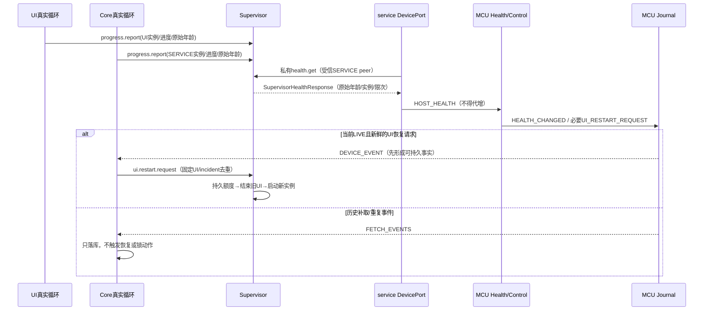

# 独立记录与监护接口设计

状态：阶段 4 的设计交接，未实现、未实测。执行任务见[阶段 4 任务卡](../stages/stage-04-monitoring-task-cards.md)。本文件细化既有端口的调用条件，不替代[阶段 0](../stages/stage-00-architecture.md)、[内部合同](internal-interfaces.md)或[UART v1](uart-v1.md)。阶段 2 已交付真实 littlefs、动作意图检查点和硬件锁截止；本阶段在该底座上完成容量管理、供电关联、真实进度监护与固定 UI 恢复。

## 1. 职责与事实来源

| 状态/资源 | 唯一所有者 | 其他模块只能做的事 |
|---|---|---|
| 借还账本、操作、主机事件游标 | RK Core / 其 SQLite 写连接 | 提交命令、事实或查询；监督进程不连接该数据库 |
| 门/在位/供电类别、物理版本、锁动作资格 | MCU Control | Health 提供健康观察；不能绕过 Control 驱动锁 |
| littlefs、已提交日志尾、持久 ACK、动作水位、回收 | MCU PeripheralStorage | Control 通过有界端口提交；Communication 不能直接读写文件系统 |
| 各任务进度样本与 IWDG 刷新资格 | MCU Health | 各任务只报告自己的进度，不替其他任务代增 |
| Core 进度 | 业务线程 | 搬运线程只读取已发布副本，不能因发送心跳而增加计数 |
| UI 进度 | LVGL 主循环 | IPC 工作者只搬运副本，不操作 LVGL 控件或伪造循环进展 |
| UI 子进程、恢复 incident、限次检查点 | locker-supervisor 的单监督循环 | 接收受限请求；不能启动任意程序、重启 service 或操作主机电源 |

健康分为“功能是否可用”和“任务是否继续运行”。日志满或挂载失败导致新开锁被拒绝，但只要本地任务仍能观察、关断和报告，MCU 可以继续喂狗。主机离线不是停止 MCU 喂狗的理由；本地关键任务卡死才撤销喂狗资格。看门狗复位也不能替代阶段 2 的硬件脉冲截止。

阶段1/2已有 `core_get_progress` → HOST_HEALTH 基线；没有UI/supervisor时明确报未知，不把尚未开发监督器当成前序阶段阻塞。新动作的主机健康前置取真实Core新鲜度；UI/supervisor缺席只显示告警，不自动恢复，也不能伪造为RUNNING。阶段4在该基线上增加观察与恢复，不撤销既有真实进度生产。

## 2. 端口、线程与完成语义

以下签名沿用生成的 [locker_contracts.h](../../contracts/include/locker_contracts.h)；所有结构体按字段处理，不能直接作为 UART 字节发送。

```c
locker_status_t mcu_journal_append(mcu_journal_t *journal,
    const locker_device_event_t *event, uint32_t token);
locker_status_t mcu_journal_read_page(mcu_journal_t *journal,
    const locker_event_key_t *after, uint8_t limit, locker_event_batch_t *result);
locker_status_t mcu_journal_ack(mcu_journal_t *journal,
    const locker_event_key_t *cursor);
locker_status_t mcu_journal_bind_sink(mcu_journal_t *journal,
    const mcu_journal_sink_t *sink);
locker_status_t mcu_board_read_inputs(locker_board_inputs_t *result);
locker_status_t mcu_control_observe_inputs(mcu_control_t *control,
    const locker_board_inputs_t *inputs);
locker_status_t mcu_health_report_progress(mcu_health_t *health,
    uint8_t task_id, uint64_t progress);
locker_status_t mcu_health_evaluate(mcu_health_t *health, uint64_t monotonic_ms);
locker_status_t locker_supervisor_report_progress(locker_supervisor_t *supervisor,
    const locker_progress_t *progress);
locker_status_t locker_supervisor_request_ui_restart(locker_supervisor_t *supervisor,
    const locker_restart_request_t *request);
locker_status_t locker_device_send_health(locker_device_t *device,
    const locker_health_report_t *report);
locker_status_t locker_supervisor_get_health(locker_supervisor_t *supervisor,
    locker_supervisor_health_t *result);
locker_status_t locker_core_apply_supervisor_health(locker_core_t *core,
    const locker_supervisor_health_t *health);
locker_status_t locker_core_get_progress(locker_core_t *core,
    locker_progress_t *result);
```

| 入口 | 调用和返回条件 |
|---|---|
| Journal append | 复制到有界队列；同步成功只说明接纳。Storage 独占执行，持久化成功才以 token 回执；token 在所有回执消费前不复用 |
| Journal read_page / ack | Communication 交给 Storage 所有者执行；线程内包装不能在 UART ISR 等待。read_page 最多 4 条，ack 成功含持久水位提交，不代表已立即擦除 |
| Journal sink | 启动 Storage 前绑定，静态 Control 依赖活到任务结束。回调只借用参数，复制 token/result 入 Control 队列；回调不调用 GPIO |
| board_read_inputs | 有界、非阻塞地读取最近完成的 ADC/GPIO 副本；未知保留有效性，不在此等待 DMA 完成 |
| control_observe_inputs | Control 唯一更新物理状态，按稳定类别变化生成事实并更新 physical_revision |
| health_report_progress | 各真实任务完成一次受监护工作循环后报告。Health 保存接收时刻和最后增加时刻；重复计数不刷新“最后进展” |
| health_evaluate | Health 周期调用；检查关键任务和 IWDG 期限，生成状态变化；评估函数被调用并不等于喂狗条件成立 |
| supervisor_report_progress | supervisor.sock 验证 SO_PEERCRED、部署 UID 和实例后交监督循环。ACK 仅表示该观测已接收 |
| supervisor_request_ui_restart | 固定 UI，incident 去重、持久限次、冷却后接受。QUEUED/STARTED 不能当作可用 |
| device_send_health | service 的设备适配器发送已观察的 Core/UI 副本；保留实例、观察年龄和未知值，绝不代增进度 |
| supervisor_get_health | 监督循环取得一致的只读观察副本；不推进进度、不创建恢复、不卡在其他进程响应上。跨进程通过health.get取得，不能传ctx指针 |
| core_apply_supervisor_health | Runtime监护worker复制监督样本入Core有界队列；返回接纳不表示投影已更新。Core线程验证样本时效后独占更新公开Device健康投影 |
| core_get_progress | Runtime监护worker非阻塞读取Core线程已发布的不可变进度副本；不排队、不I/O、不自增，不使用Core查询队列证明该队列自身健康 |

模块销毁沿用内部合同。supervisor 的循环、子进程处理和 IPC 工作者全部停止后才 `locker_supervisor_destroy`。supervisor 退出不得先遗忘仍存活的 UI 而启动第二份；进程重启先依据受控 PID/进程身份核对。UI 或 service 退出时作废其实例绑定，旧实例的晚到报告不得复活新鲜度。

## 3. 日志容量与回收

### 容量策略

阶段 2 的 Flash 几何和 littlefs 分区是输入，不按候选板宣传容量填写常量。容量报告必须同时给出：物理容量、分区容量、文件系统实际已用/可用、段/记录开销、检查点预留、文件数上限和关键事件队列上限。96 字节是线上事件体长度，不是 littlefs 每条记录的实际占用，不能用“容量÷96”承诺存储天数。

预留空间至少覆盖一次最大动作检查点提交、故障/连续性标记及元数据更新；具体字节数来自最坏提交写入量和实测。达到预留水位立即拒绝新动作，不能等物理字节彻底耗尽才拒绝。预留区不作为无限离线记录承诺：无可用空间时仍观察和关断，记录无法写入的事实必须通过连续性失效、`dropped_events` 或未知哨兵可见。

### 回收事务顺序

1. RK 通过 `locker_repo_import_events` 将唯一事实、投影与连续游标同一事务提交。
2. Core 调用 `locker_device_ack_persisted` → UART `ACK_PERSISTED` → Storage `mcu_journal_ack`。
3. Storage 核对同 epoch、非倒退、不越已提交尾、不跨未承认缺口，先可靠提交 ACK 水位。
4. 仅回收完全落在该水位以内、且不承载未决动作依据的完整段。保留最新动作水位、活动/未知结果检查点、日志 epoch/boot 和连续性锁存。
5. 回收后推进 `first_available`。`last_committed`、ACK 与动作水位不得倒退；掉电后可重复回收，但不能重新驱动动作。

ACK 丢失只导致保留更多记录；段删除失败不能伪装删除成功。旧页已回收的 FETCH 必须返回 `gap_before_page` 和可用边界，不能构造假页补齐。容量恢复不自动清 `HISTORY_INCOMPLETE`、`dropped_events` 或未决操作，也不自动 READY；仍按屏障和 CAS 核对。

保留策略：MCU 未 ACK 记录及未决动作依据不按时间淘汰；RK 原始设备事件、业务审计和借还历史首版不自动删除；普通诊断文本可有界轮转，不包含敏感字段且不能代替事实日志。SQLite/WAL 或磁盘满时停止新动作发送、停止 ACK 未提交事实；不得删库或用成功提示遮盖落库失败。[SQLite WAL 说明](https://www.sqlite.org/wal.html)用于安排检查点与长读事务验证，不将 WAL 文件当作可随意删除的缓存。

### 存储私有实现边界

以下是 Storage 同一 `.c` 内的辅助签名设计，不是新增跨模块端口，也不进入公开 API、UART 或通用头文件：

```c
typedef struct {
    uint32_t partition_bytes, used_bytes, reclaimable_bytes, reserved_bytes;
    uint32_t segment_count, segment_limit;
    bool continuity_ok, admission_has_space;
} journal_capacity_view_t;
static locker_status_t journal_measure_capacity(
    mcu_journal_t *journal, journal_capacity_view_t *out);
static locker_status_t journal_reclaim_acked_segments(
    mcu_journal_t *journal, const locker_event_key_t *durable_ack);
```

`out` 为调用期间借用的调用者缓冲；只在 Storage 中调用。`reclaimable_bytes` 是保守可回收估计，不是删除授权；helper 内仍逐段核对持久 ACK 和未决引用。禁止在 Health 中直接调用 littlefs 获取容量。

## 4. 供电关联与归因边界

链路：HAL ADC 最近完成样本 → `mcu_board_read_inputs` → Control `mcu_control_observe_inputs` → `SUPPLY_CHANGED` → Journal → 实时事件/后续 FETCH → Core 落库 → 有权限的设备/事件查询。

- 阶段 2 已标定 ADC，本阶段只补充阈值、滞回、持续时间与故障关联；数值由实际输入额定范围、分压及测量结果确定。无标定不得填“12V正常阈值”。
- 供电类别编号随本地验证 profile 和固件版本记录，`SUPPLY_CHANGED.detail` 使用该映射。未知不默认正常，类别变化才更新物理版本，噪声采样不逐次生成事件。
- `supply_mv` 线上未知为 `0xffffffff` 且 SUPPLY_VALID 清零，对外 JSON 为 null；0mV 是有效零值。ADC 越量程/过期视为未知。
- 电压异常可关闭新动作入口；电压恢复仍需当前输入、日志连续性和未决操作核对。不能仅凭电压恢复自动完成借还或消除 hold。
- 同 boot 下按 MCU 单调时间关联供电变化、HOST_HEALTH 停滞和门/物品事实。TIME_ANCHOR 仅补充时间质量；补传接收时刻不作为发生时刻。
- 已有硬件无 UPS，MCU 自身突然掉电时可能来不及提交末尾事实；能确认的只有已提交边界、复位原因和恢复后的状态。不能把“最后一条低压记录”断言为故障根因，不能声称记录了 MCU 断电期间全部变化。

## 5. 真实进度与 MCU 看门狗

各计数在所属实例/boot 内严格增加。重复值可表示仍停滞，回退非法；进程重启使用新 instance_id，MCU 重启使用新 boot_id。64 位计数在 F407 上通过临界区/消息副本读取，不能接受撕裂值。接收报告、发送心跳、ISR Tick 和软件定时器均不能替实际任务增加进度。

| 生产者 | 可以增加计数的位置 | 不能算进展 |
|---|---|---|
| Core | 业务线程完成一次有界队列处理与超时检查，处理结果/空队列检查已完成 | 网络线程响应正常、独立定时器递增、卡住事务期间搬运旧值 |
| UI | 新实例登录页可交互后，LVGL主循环完成输入/结果消费、`lv_timer_handler`及本轮必要页面投影；未登录也可报告真实进展 | 仅IPC线程存活、页面尚不可交互、独立心跳线程、渲染函数进入但未返回 |
| Control | 完成输入观察、命令状态和截止检查的一轮工作 | 只运行定时中断，队列消费者阻塞不返回 |
| Communication | 完成本轮 DMA/串口状态、接收解析和发送队列检查 | ISR 有数据却解析任务不运行，链路空闲被误判为死机 |
| PeripheralStorage | 完成一次工作或完成有界空队列/驱动状态检查 | 异步“开始擦除”后永久 busy，错误被无界重试 |
| Health | 完成各关键任务期限检查及安全输出决定 | 自增计数为其他任务补健康，刷新 IWDG 后才检查条件 |

`mcu_health_config_t.task_deadline_ms[4]` 按真源固定 CONTROL=0、COMMUNICATION=1、PERIPHERAL_STORAGE=2、HEALTH=3；不得把 `task_id` 当作 FreeRTOS 动态句柄或发送到 UART。每个期限需大于已测正常最坏周期且小于能接受的检测上限；Storage 的擦写上界单独测量，不能运行时无限延长期限来迁就卡死。

只有 Health 的 HAL 私有 IWDG 适配能刷新 IWDG。启动配置记录 LSI 误差允许范围、重装载值和实测复位窗口；不硬写跨板通用秒数。Health 也停滞时由 IWDG 自身超时复位，复位默认关锁；启用调试冻结的实验结果不能充当实际复位证据。仅本地关键任务及时推进且没有危及关断/观察能力的故障才刷新。Linux/UI 离线与已处理的日志满属于功能退化，不能诱发 MCU 反复复位丢记录。

## 6. RK 观察搬运与固定 UI 恢复

### 私有 RPC

沿用 `/run/locker/supervisor.sock`、AF_UNIX SOCK_SEQPACKET、8192 字节请求/65535 字节响应；请求完整 schema 与返回以机器真源为准，不能增加未声明字段。

| 方法 | 参数与成功含义 |
|---|---|
| `progress.report` | target=SERVICE/UI、instance_id、u64字符串progress与sampled_mono_ms、observed_age_ms；200 PROGRESS_RECORDED 只确认报告接收 |
| `ui.restart.request` | target固定UI、reason≤64字符、incident_id；202及QUEUED/STARTED/OBSERVED_RUNNING/FAILED；重试同incident返回既有状态，不再恢复一次 |
| `health.get` | 仅受信service peer，params=null、无session_token/幂等键；只读返回SupervisorHealthResponse，不创建或刷新健康 |

peer的UID/PID与实例绑定。SERVICE来自固定service UID；UI来自受控UI UID/进程身份；PID回收不能沿用旧实例。C的progress target按真源SERVICE=0、UI=1，JSON仍为对应字符串。生产者用实际完成循环的CLOCK_MONOTONIC生成sampled_mono_ms，观察年龄以该采样时刻为基点；Runtime/IPC搬运保留原时间，不因发送而重打时间。

接收者拒绝未来采样、同实例的乱序采样及计数回退；已知样本的有效年龄为 `max(饱和加(observed_age_ms, now-sampled_mono_ms), now-last_strict_increase_mono_ms)`，不是将两个重叠区间再相加。严格增加时保存该生产样本；相同progress即使sampled_mono_ms更新，也不能替换最后严格增加的健康依据。下游返回/搬运该保存的原始样本，不把重复收包转换成新鲜观测。未知年龄保留未知，线协议搬运时饱和为UINT32_MAX，不能溢出变新鲜。

### 实例启动与限次

supervisor_config.recovery_enabled=false为正式观察模式，只提供实例/进度/只读健康，不启动/结束UI且拒绝恢复请求；S4-04先交付此模式。只有S4-05完整验收后才允许true，由监督器唯一管理固定UI。该配置只在本机部署，不通过HTTP修改。观察模式接收手工启动UI时须校验peer UID、PID启动身份及/proc/<pid>/exe等于配置固定路径，并限制一个当前实例；切换管理模式先核对/结束该受控实例，不启动第二份。

监督器固定 `ui_executable`，固定参数和受控环境，不执行 shell。首次启动 UI 宽限 30 秒；主机初始化宽限 120 秒只抑制早期误告警，不授予 READY。正常每秒搬运，5 秒无真实进展视为失联/停滞。UI 恢复最多 10 分钟 3 次，至少 60 秒冷却，接受恢复前先持久记录额度与 incident，再有界结束旧 UI 并确认退出后启动新实例。

独立检查点存监督身份版本、Linux boot 身份、该 boot 单调时间、最近恢复尝试和 incident 结果；不使用借还数据库。监督进程自身重启不能重置限次；检查点损坏/无法写入时进入 LIMITED，不自动无限拉起。跨 Linux boot 的单调时间不可比较；持久余量无法安全推导时保守等待完整窗口，并保留历史，不能借主机重启立即清额度。恢复计数是“已持久接受的恢复尝试数”，实际UI恢复另由新实例登录页可交互及真实循环进度证明。

新UI启动后清除旧会话token，回到登录页，不重放上次presence、借还确认或UI事件队列。每个新UI实例progress从0开始；登录页可交互且真实完整LVGL循环完成后即可产生非零进度，无需等待用户登录。监督器必须在30秒启动宽限内观察期望新instance的非零progress至少两次严格增加、且两次源样本均新鲜，才报告OBSERVED_RUNNING；进程创建成功、PID存在、IPC建连或单个非零报告均不充分。

OBSERVED_RUNNING仅证明UI已恢复到可交互页面，不证明业务状态已同步。登录成功/服务重连后，借还等业务按钮仍须等待当前用户的fresh getSnapshot完成校验与投影，再按服务端allowed_actions开放。不得保存旧token绕过登录，也不增加匿名snapshot接口。正常无人值守登录页持续推进时，应在启动宽限内判为UI恢复，不能因无人登录反复重启。

service健康不佳/不可达导致UI不能同步时，保留状态并停止反复拉起UI，不能通过不断重启UI修复服务故障。service不因UI恢复清空或改写业务操作，也不自动重启；人工重新启动service后仍先核对。

### 监督观察只读回传

Runtime监护worker读取 `locker_core_get_progress` 已发布的副本后上报progress.report，不能借自己的定时执行改变Core计数；每秒最多查询一次 `health.get`。监督器经 `locker_supervisor_get_health` 返回不可变副本。SupervisorHealthResponse含supervisor_instance_id、sampled_mono_ms、可null的service/ui观察（instance_id、progress、sampled_mono_ms、observed_age_ms）、state、可null的restart_count、window_attempts、cooldown_remaining_ms、budget_ready。外层采样表示监督副本形成时刻，内层保留对应真实进度采样时刻，不能互换。JSON u64均为十进制字符串，具体范围按0.2.1机器真源。

查询者是已经以SERVICE进度报告建立可信实例绑定的service peer，token/null和peer边界不接受手机绕行。未绑定、错误UID、旧实例连接拒绝。限时查询超时不阻塞Core/UI，观察逐渐过期；未知不能填0称健康。C结构体中未知的有效位/枚举以生成声明为准，不自行把JSON null布局复制到C。

DevicePort仍由service独占。HOST_HEALTH的Core实例/计数始终取本机locker_core_get_progress源副本，supervisor不存在不能抹掉真实Core健康；监督返回的service观察只作交叉诊断。UI取监督保存的最后严格递增源样本。各按饱和加(source_age, now-source_sample)累计一次，不在已累计值上叠加外层sample覆盖的时间；外层sample只判断缓存时效。两进程同一Linux boot；未来/无法核对样本作未知，未知线上实例全0、年龄UINT32_MAX。

Runtime通过 `locker_core_apply_supervisor_health` 将同一副本复制入Core，由Core唯一更新Device健康原因与ui_restart_count。Runtime不直接改投影、不写数据库。查询失败不刷新缓存采样时刻，Core按原样本年龄继续老化；未知或过期的restart_count映射为null，不能用0冒充已知未恢复。入Core队列失败按背压处理，不静默覆盖样本继续上报全健康；Core进度自身停滞时即使Runtime还在运行也不能生成新鲜Core进度。新supervisor实例的旧副本不得覆盖已接纳的新样本。监护worker退出后不再提交，Core停止/销毁沿用Runtime统一顺序。

## 7. 监护到业务的完整调用链



监督器可以依据自己的当前UI观察发起同一固定恢复流程；来自MCU的请求必须由Core验证当前session、LIVE来源及观察新鲜度后转送。每个UI_RESTART_REQUEST事件键确定性派生一个incident_id：采用标准UUIDv5，namespace为URL namespace `6ba7b811-9dad-11d1-80b4-00c04fd430c8`，UTF-8名称为 `urn:locker:ui-restart:<device_id>:<journal_epoch>:<boot_id>:<event_seq>`，device_id/epoch使用真源规范小写文本，u64使用无前导零十进制。相同事实始终同incident，不能每次随机生成；该UUID只是关联键，不是身份认证。

监督检查点持久保留已接纳incident结果；历史不重新执行。跨源并发请求在监督单循环合并为同一活动故障，限次始终统一执行。旧实例/旧session/REPLAY/已过期请求仅保留诊断，不产生恢复，更不产生锁动作。

普通App仅通过 `GET /api/v1/snapshot` / `GET /api/v1/device` 读取健康投影，`GET /api/v1/events` 按权限读取事件；WS仅提示重查。不得提供手机“重启服务”“复位主机”“清日志”“模拟低压”或“忽略缺口”入口。service被人工重新启动后只做HELLO→屏障快照→补取落库→ACK→核对→CAS；进程启动成功不等于READY。

## 8. 资源、诊断与复用结论

- 队列、文件数、窗口内 incident、每实例样本均有编译/部署上限；样本按 target 只保留当前/受核对旧实例，不积累无限列表。窗口记录可回收过期恢复尝试，但业务审计不因此删除。完成响应有界；队列满返回既有 QUEUE_FULL/BUSY/NOT_READY 粗分类，不覆盖最旧关键事实。
- `HEALTH_CHANGED` / `JOURNAL_FAULT` 使用既有事件类型，reason 为既有 wire_result，detail 保留固件诊断位/驱动码。诊断映射随固件版本存证，不能由 App 按未冻结位值控制动作。供电类别映射同理。
- 日志关联 device/epoch/boot/seq、operation/command、instance/incident；不记录 token、密码、私钥或原始卡 UID。可见数据的权限沿用公开 API，监护不创建第二套用户系统。

| 方案及一手依据 | 许可/维护评估 | 本项目复用与适配成本 |
|---|---|---|
| [littlefs 官方实现](https://github.com/littlefs-project/littlefs)、[设计](https://github.com/littlefs-project/littlefs/blob/master/DESIGN.md) | BSD-3-Clause；官方仓库有测试和技术规格，实施锁定阶段 2 版本而非追随master | 复用掉电一致性与磨损处理；业务ACK/意图检查点仍由本项目封装。sync/close完成才算提交，不能照抄示例mount失败format |
| [FreeRTOS Kernel](https://github.com/FreeRTOS/FreeRTOS-Kernel)、[许可](https://github.com/FreeRTOS/FreeRTOS-Kernel/blob/main/LICENSE.md) | MIT；官方内核持续维护，沿用阶段 2 锁定版本 | 复用任务/队列；不另造调度器。watchdog策略需结合本项目任务进展，不能只用tick/idle信号证明关键任务健康 |
| [ST HAL IWDG](https://github.com/STMicroelectronics/stm32f4xx-hal-driver/blob/master/Src/stm32f4xx_hal_iwdg.c) | 官方HAL来源；沿用本地V1.8.5许可与版本，不以网页master替换用户原库 | 复用HAL初始化/刷新入口，Health独占刷新；LSI与复位证据在实物核准 |
| [LVGL官方循环/线程说明](https://github.com/lvgl/lvgl/blob/master/docs/src/integration/overview.mdx)、[许可](https://github.com/lvgl/lvgl/blob/master/LICENCE.txt) | MIT；官方实现和文档活跃，沿用阶段 3 锁定版本 | 主循环完成才生成UI进度；搬运线程不碰控件，不迁移到另一GUI框架 |

以上为 2026-10-20 的方案调研，不代表完成依赖漏洞审计或下载。首版采用小型固定目标监督器；完整通用进程管理器会扩大配置/权限范围，目标机 init 未确认前不新增依赖。所有验收均需在阶段 4 执行并留证，本文件没有任何实测结果。
