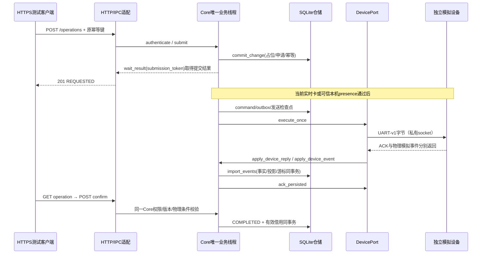
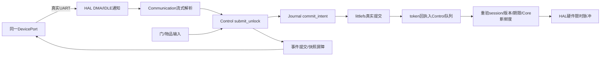
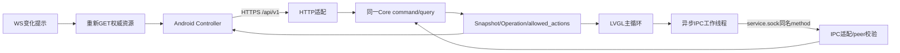
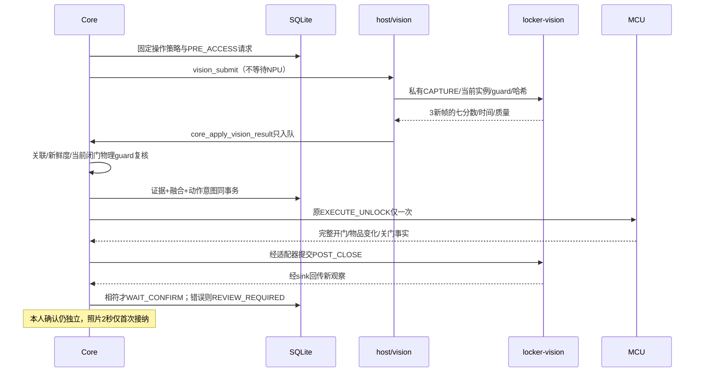

# 按阶段接通的 API 调用链

阶段2分基础2A与视觉2B；S2-16是完整门禁，S2-08仅基础。新增F6视觉链的字段见[视觉接口](vision-interfaces.md)。

状态：契约0.2.1设计。以下为后续要实现和验证的链路，不是已运行截图。每条链的任务归属见[接口追踪表](traceability.md)，执行方式见[阶段入口](../stages/README.md)。

## F1：主机模拟闭环（阶段1）



HTTP/IPC最多等待Core结果1000ms；超时不取消。已知operation_id就查询，不知则保留原键原意图核对。半帧/丢ACK由模拟器私有控制端注入，公共API不加simulate/unlock入口。S1-07必须经过真实HTTPS/IPC和字节流，不仅直接调用领域函数。

基线健康在S1-04/06实现：Core完成真实回路发布不可变进度→Runtime非阻塞get_progress→DevicePort HOST_HEALTH。没有supervisor/UI时明确未知；不能因后续监护未写而伪造进度，也不因此阻塞阶段2。

## F2：HAL 实物链与恢复（阶段2）



`EXECUTE_UNLOCK`只发送一次；ACK丢失走`QUERY_COMMAND`。MCU先提交意图再驱动，硬截止不依赖存储/调度/Linux。重连固定为HELLO→GET_SNAPSHOT屏障→FETCH_EVENTS→RK事务提交→ACK_PERSISTED→核对→RESUME_READY物理版本CAS。历史CARD_OBSERVED不开柜，旧outbox不迁移到新session。

S2-04真实Journal、S2-05硬截止先通过，再做S2-07借还；不能到阶段4才补持久化。实物端尚未启动IWDG完整策略时，不宣称阶段4已完成。

## F3：Android 与触摸端统一业务（阶段3）

前置S2-16通过；消费两条视觉只读GET并展示Core结论，客户端不分类或绕过原物理/本人确认规则。



手机先导入柜体公开证书材料并柜前核对→login→getCurrentSession/getDevice/getSnapshot；HTTPS/WSS同一TLS信任与Bearer，token不放URL。触摸端登录同一用户体系，`presence.submit`额外核验UI peer+owner；手机没有该方法。两端不能把201/ACK显示为借还完成。

mutation先保存非敏感意图和原幂等键；createUser/login密码例外不落盘。WS只提示查询，前台10秒刷新兜底，切用户/页面generation变化丢弃旧响应。LVGL主线程不等网络，IPC线程不改控件。UI真实进度从已完成循环产生；重启清token回登录页，业务按钮等登录后新鲜快照。

## F4：独立监护与恢复（阶段4）

```text
Core真实回路 → core_get_progress不可变副本 → Runtime → supervisor progress.report
LVGL真实回路 → IPC搬运原sample → supervisor progress.report
Runtime → supervisor health.get → 一致健康副本
  ├→ core_apply_supervisor_health排队 → Core独占更新公开健康投影
  └→ DevicePort HOST_HEALTH → MCU Health → Journal健康/供电事实
LIVE且新鲜UI故障事实 → Core → supervisor ui.restart.request(确定incident)
  → 持久限次 → 确认旧UI退出 → 新UI实例 → 两次真实递增 → OBSERVED_RUNNING
REPLAY/旧会话/过期事实 → 只存记录，不恢复、不驱动锁
```

ProgressReport的sampled_mono_ms取源CLOCK_MONOTONIC，排队/复制不更新时间。同counter重复不能延长健康；未知年龄用哨兵。service/ui不同实例不拼成一个新鲜样本。服务或Core停滞时，搬运线程仍活着不能掩盖停滞。

S4-04先实现可独立启动的只观察supervisor；S4-05再启用固定UI恢复。恢复成功只表示新实例登录页可交互和真实循环推进，不要求先登录；业务数据同步另由登录后快照门禁。service失联只记录，不自动重启或硬复位主机。

## F5：部署与离线维护（阶段5）

```text
固定发布包 → verify-release(哈希/目标/schema/Journal兼容)
→ 管理员处理未决操作与实物 → 停service并取得同一维护互斥
→ sqlite3_backup独立副本 → 校验/manifest
→ 切兼容程序/配置 → 人工启动service → 新session/补取/核对/CAS
```

配对公开材料首用在S2-06已可导出，本阶段固化维护方式。程序回退不回退DB/MCU日志/动作水位/监督额度；旧备份只能隔离检查，不能一键覆盖后READY。不兼容数据格式停止更新，另做迁移设计。该链没有手机远程shell、格式化或直接开锁接口。

## F6：视觉证据接入（阶段2B）



PRE失败无动作，POST失败保占位；同guard的已提交POST证据可在原120秒确认窗口使用。原样本和融合都保留，GET /operations/<id>/vision按受控operation前缀查询历史，无采集副作用。基础2A不把视觉标成功；2B无相机/预算/阈值/SDK证据不通过。完整实施说明见[AI接线](vision-ai-handoff.md)。
