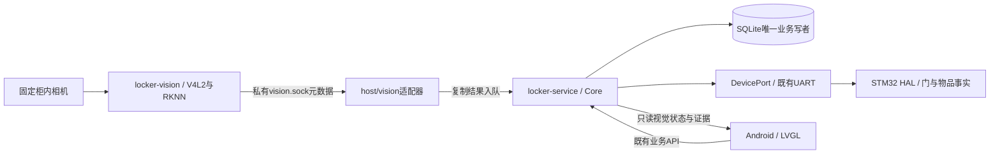

# v11 器材视觉识别的架构与接口

状态：契约0.2.1的设计交接，未实现视觉进程、相机采集或RKNN部署。范围为一柜格、一件固定配置的工具；执行见[阶段2B任务卡](../stages/stage-02b-vision-task-cards.md)。阶段2A保留S2-01—08，阶段2B新增S2-09—16，原有后续卡ID保持不变。

## 1. 模型事实与采用范围

用户模型目录为E:/equipment-vision，当前选用models/v11_with_empty/best.pt。v11是用户的训练迭代号，架构是MobileNetV3-Large，属于整图分类，不是YOLOv11目标检测。输入224×224，输出顺序固定为empty、heat_gun、multimeter、oscilloscope、power_supply、soldering_iron、wire_cutter。类别顺序须随模型包核对，不能由文件名或界面中文排序重建。

只读核对已确认默认equipment_cls/best.pt与v11权重相同，现有model.onnx为动态batch、3×224×224输入、7维logits输出、opset18；不能称其为旧六类模型。当前没有.rknn，尚缺逐样本导出等价、量化评估和板端验证。metrics.json记录最佳验证准确率0.9241706161、211张验证图；README的91.9%是另一记录，均不作为本柜实测准确率或验收保证。

README、部署指南和示例是调研输入，不是柜体执行协议。它们存在预处理不一致、重复归一化风险、empty业务解释错误及公网任意图片路径示例，后续AI不得直接复制其服务骨架。模型项目和原权重本轮保持不变，模型导入/转换在对应卡中显式执行并留下来源与哈希。

模型只识别器材类别，不能证明同一类别中的资产编号、数量、真伪或完整性。一相机照多格、多物体检测、持续视频监控、人脸识别均不属于首版。

## 2. 进程、权限与数据所有权

- locker-vision独占相机FD、帧缓冲、RKNN context和预处理；生产实现采用RKNN C API及V4L2，不把训练环境/PyTorch装进柜体业务服务。原型脚本可作参考，不直接充当正式进程。
- host/vision独占vision.sock客户端与有界在途表，负责协议/实例/超时/结果关联；不写业务数据库，不访问UART，不判断借还完成。
- Core独占expected_class、借还账本、操作状态、持久证据、视觉策略和最终融合判断。视觉返回的是类别/分数/质量元数据，不是开锁授权。
- MCU仍是物理事实与锁驱动执行者，HAL和11类UART消息不因接相机而改变。视觉线程不进入MCU固件，也不把预测类别写成item_state。
- UI、手机和supervisor不直接连接vision.sock。视觉进程不控制锁，不自动重启locker-service；退出/卡死通过结果超时与状态变化变为不可用，恢复后也不重放旧采集请求或动作。

相机接口已定为USB2.0 UVC免驱定焦模组（候选CAM-UVC-01），判据、机位与到货验证见[相机选型与成本](../hardware/相机选型与成本.md)。仍未购买、未核价、未接板，驱动/安装/曝光回读/阈值标定均未验证；选MIPI CSI需先登记板型并完成rkisp设备树与IQ调试，不在首版范围。视觉增量为独立预算：已选定HBVCAM-F2170HD（75°手动调焦）与5V白光补光，页面价合计50.56元、单独上限55元，补光用用户已有5V充电头独立供电、随附线与固定复用，不占用也不从200元配件预算扣减，不能默认填0或替换保护件凑预算。未满足相机/profile与预算门槛，实物视觉卡如实BLOCKED。

## 3. 三种部署模式

| 模式 | 用途 | 对借还的影响 |
|---|---|---|
| DISABLED_FOR_FOUNDATION | 仅阶段2A底座验收 | 明确标为无视觉基线；S2-08通过不代表完整产品通过 |
| SHADOW | 柜内数据与模型效果验证 | 保留视觉结果，沿用原物理业务；所有结果标影子模式，不能宣传错还拦截已生效 |
| REQUIRED | 最终集成部署 | 每次操作按冻结策略满足前后视觉门槛；故障/旧证据/不确定不得静默降为SHADOW或无视觉 |

模式、expected_class、模型包、相机profile及阈值策略只通过受限本机配置维护，不增加手机切换开关。模式与相关哈希在操作/采集上下文中冻结；有未决操作时不热切模型或策略绕过原门槛。阈值、图像质量判据、量化效果或相机profile未标定，REQUIRED不得开启。

## 4. 工具、物理与视觉三种事实

expected_class来自单件工具的明确配置，例如万用表格固定为multimeter；不能用第一次预测替代工具建档。empty不是可借状态，也不是已还状态。微动开关回答槽位物理在位，分类器回答画面像哪类器材，账本回答谁借走了什么；三者不得互相覆盖。

| 检查点 | BORROW借出 | RETURN归还 |
|---|---|---|
| PRE_ACCESS开锁前 | 门关、物理PRESENT、视觉MATCH固定expected_class | 门关、物理ABSENT、视觉EMPTY |
| POST_CLOSE取放并关门后 | 原连续事实成立、物理ABSENT、视觉EMPTY | 原连续事实成立、物理PRESENT、视觉MATCH固定expected_class |
| 最终完成 | 以上成立、证据仍有效、本人确认 | 以上成立、证据仍有效、本人确认，关闭原借用 |

MATCH仅表示类别吻合，不称“原物归还认证”。低softmax、类间接近、模糊/遮挡/曝光失效不得判empty；empty必须是明确预测类且满足校准后的质量与稳定性条件。传感器与视觉冲突保留双方证据，不能因为“物理优先”就忽略错还风险自动完成。

只开关门不取放的NO_CHANGE路径也核对原基线：借出物品始终PRESENT且POST仍MATCH、归还始终ABSENT且POST仍EMPTY才NO_CHANGE；矛盾/不可用转REVIEW_REQUIRED。它不创建或关闭借用，不能把正常未取物强行要求为空。

## 5. 采集绑定与过期

Core为每次检查生成capture_id，绑定operation、PRE_ACCESS/POST_CLOSE、预期类别、当前MCU journal_epoch/boot/physical_revision、service实例、worker实例、camera generation，以及bundle/preprocess/policy/profile哈希。完整字段与范围以机器契约为准，调用方不自编另一份JSON。

Core在采集前取得当前闭门稳定物理guard；worker只回显相关guard，不声称能验证MCU事实。采集后Core再次核对仍为同一闭门物理版本、同一操作和当前服务/设备会话；期间开门、物品变化、重启、重连、模型/相机代际变化或操作推进使结果不再符合guard，判STALE或CONFLICT，不“收到即成功”。

相机不能用请求前缓存照片充当当前证据。首版设计采集3个新的帧序号，帧间隔至少100ms，总采集截止3000ms；这些是待实测的设计边界，不是RK3568性能结论。新帧可像素相同，但必须来自不同真实采集序号/时间，不能同一缓冲重复推理3次。V4L2时间戳需验证其时钟/标志并映射同一Linux boot的CLOCK_MONOTONIC；仅用dequeue时间无法证明曝光时间时，REQUIRED不能据此接纳旧缓冲。

固定相机ROI先完成颜色解码，再执行与参考一致的resize/crop。更换机位、镜头/分辨率、ROI、相机重新打开或掉线重连均生成新camera generation；未决请求在代际切换时失效。图像质量或稳定性不合格只能UNCERTAIN/失败，不拼凑来自不同guard的“多数票”。

## 6. 异步端口与私有协议

跨模块端口使用生成C头中的locker_vision_create、bind_sink、open、submit、get_status、close、destroy，以及locker_core_bind_vision、apply_vision_result、apply_vision_status。本文只规定调用语义，不复制尚会随机器契约生成的参数结构布局。

装配：创建vision适配器→Core创建后bind_vision→绑定结果/状态sink→启动Core→打开适配器；依赖在回调结束前保持存活。submit只表示复制入有界队列；接纳、相机采集、NPU完成、Core落库和业务融合是不同结果。get_status读已发布不可变副本，Core不在此等待socket/NPU。

停机先停止外部接单与视觉新提交，close中终止IO/等待回调退出，Core再收敛结果并停止，最后销毁适配器与Core。停止超时不能释放仍被线程引用对象。worker重启清在途采集；晚到结果按capture/实例/代际拒绝，不能自动发新请求补成原成功。

vision.sock采用本机私有Unix socket与有界JSON请求/响应，只有固定service UID可连接，验证SO_PEERCRED及部署权限。它有独立协议版本/包络，不把vision方法加入普通service.sock或supervisor.sock；无公网监听，无GET /classify?path。请求只引用固定slot/camera和采集上下文，不传任意路径、URL、shell、客户端图片或预期“成功结果”。具体消息字段、上限、错误及关联以机器契约固定。

worker只向适配器返回有界分类/时间/质量/来源元数据；原始帧、JPEG/base64、视频流不入Core队列、SQLite业务记录或公开API。默认不留图；若现场标定需样本，使用受限离线采集目录和明确保留策略，与生产证据链分开，不增加远程图片下载接口。

## 7. Core融合、持久化与错误出口

PRE_ACCESS在REQUESTED且有效柜前证明成立时启动，避免用户尚未到柜时拍一张长期复用。采集期间不建command/outbox、不预先发EXECUTE。成功后仍重新检查本人证明剩余有效期、权限、日志、物理版本和原动作期限，再按原事务与一次发送规则执行。证据或证明过期重新获取有效输入，不能延长旧证明。

PRE_ACCESS失败/不确定：没有动作意图，操作保持REQUESTED，明确显示原因，可按原规则取消/超时或现场检查；不能绕过视觉立即开门。POST_CLOSE失败/不确定/超时：可能已有取放，进入REVIEW_REQUIRED并保留占位，不把物品重新标可借。完整物理过程成立而后视觉尚在采集时，只显示检查中，不能提前授权confirm；成功才进入可确认条件。

Core接到结果先校验捕获关联/guard/包来源，再把原观察、融合结论、策略来源、资源版本与操作变化同一仓储事务提交。落库失败不更新成功投影，不能只存一个MATCH布尔值而丢原类别/分数与来源。重复capture只入库一次；与原capture同ID不同内容拒绝并诊断，不覆盖历史。

最终confirm再次检查当前物理状态/版本、当前操作及引用证据仍有效；确认响应丢失沿用原幂等键，不重新开锁。服务/worker/MCU重启后未决采集不自动复用；原证据保留作历史，恢复先按原日志屏障核对，不把旧照片升级成新会话实时证据。

max_result_age_ms=2000只用于Core首次接纳逐帧结果；证据提交后记录accepted_mono_ms，可在120秒WAIT_CONFIRM内供本人确认。期间guard/实例/模型策略/相机代际须保持有效，确认再核对新鲜物理快照；不要求用户2秒点击或循环重拍。变化/健康未知使证据失效并转核验。

人工resolve仍只允许原有物理规则支持的完成借出/完成归还/NO_CHANGE，并保留管理员、原因、视觉矛盾及人工处理标识。人工核验不删除原视觉结果、不把错误结果改为MATCH、不在传感器UNKNOWN时强制完成。

## 8. 公开只读 API 与客户端

| 入口 | 用户能看到什么 | 不能做什么 |
|---|---|---|
| GET /api/v1/vision/status，getVisionStatus | 当前模式、模型/相机可用性、校验状态与有界原因 | 修改阈值/模式、上传图片、开锁或重启进程 |
| GET /api/v1/operations/{operation_id}/vision，getOperationVisionEvidence | 本人操作或管理员获准查看的前后检查摘要、原结论/融合状态/来源 | 越权读他人操作、获取图像/本机路径、伪造证据 |

普通用户仅看本人操作证据，管理员仍按明确权限校验，不因猜到UUID可越权。服务端从Core一致投影读取，HTTP线程不直接连worker。WS仅提示资源变化，客户端GET重查；断线/等待不把结果画成完成。

触摸端按统一业务读取接口显示同一结论，不新建本地视觉判断。页面区分“拍摄/核验中、类别吻合、空槽、无法确认、证据过期、待人工核验”；只按服务端allowed_actions开放操作。所有字段/错误/返回模型以OpenAPI和本机业务映射为准。

## 9. 一个万用表的真实例子

借出：固定配置multimeter→用户申请/到柜→闭门且开关PRESENT→3帧均满足multimeter门槛→Core提交动作→STM32开锁→开门取走/关门→开关ABSENT且3新帧满足empty→本人确认→账本记借出。

归还：用户申请归还时柜内本就应空，不在此时要求看到万用表→到柜后确认物理ABSENT/视觉EMPTY→开锁→放入/关门→开关PRESENT且新帧MATCH multimeter→本人确认→关闭借用。若放入剪线钳，开关可能仍PRESENT，但视觉为wire_cutter；保留双方事实并REVIEW_REQUIRED，不能单凭开关结束借用。

遮挡相机、拔掉相机或worker退出时，REQUIRED不静默绕过。若已经取放再故障，保持待核验和占位；没有发生动作时不发command。这也是本次引入视觉的具体价值：补充“有物但类别不对”的核验能力，而非替代门磁/微动开关或宣称防伪。

## 10. 复用与实施依据

- [RKNN Model Zoo](https://github.com/airockchip/rknn_model_zoo)：Apache-2.0，借鉴模型加载、tensor属性查询、输入/输出和资源释放，适配自训MobileNetV3；不复制ImageNet1000类标签或其示例几何预处理。
- [MobileNet C API例程](https://github.com/airockchip/rknn_model_zoo/blob/main/examples/mobilenet/cpp/rknpu2/mobilenet.cc)：参考RGB888、uint8/NHWC、浮点输出/softmax生命周期；只在已冻结的输入recipe下采用，不能靠默认格式猜测。
- [RKNN-Toolkit2](https://github.com/airockchip/rknn-toolkit2)和[SDK许可](https://github.com/airockchip/rknn-toolkit2/blob/master/LICENSE)：转换工具/runtime另有SDK许可，实施时锁定并核对板端driver/runtime/API兼容，不把整个SDK一概标Apache。

相机采集复用目标Linux的V4L2；SDK、预处理、量化、相机驱动和现场性能都在阶段2B逐卡留证。本文件没有把30—60ms、empty十四张全对或某个softmax阈值写成现场保证。
