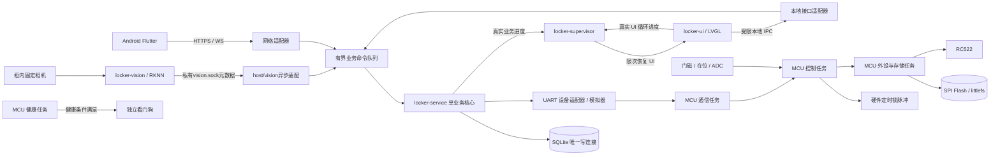

# 阶段 0：架构、功能边界与接口契约

状态：供用户评审的设计基线 v0.2.1。范围是一柜格、一件固定工具、局域网 Android App。STM32采用本地HAL V1.8.5；当前没有业务实现、MCU固件或真机验收。阶段1—5的45张卡与单卡规则见[阶段入口](README.md)。

本阶段的目标是让后续 AI 依据同一套状态、接口和失败语义分工，不让三端各自发明借还规则。阶段 1 只实现主机骨架和模拟器，任务卡单独交接。

## 1. 本阶段交付与阅读顺序

| 交付 | 用途 |
|---|---|
| 本文件 | 人可读的架构、业务状态、信任边界和决策 |
| `contracts/contract-source.json` | 枚举、错误、API、线协议字段与端口目录的机器真源 |
| `contracts/uart-layouts.json` | 串口字节字段真源，与根契约共享枚举 |
| `contracts/internal-data-source.json` / `internal-data.schema.json` | 仓储事务、分页恢复与命令映射真源/派生 schema |
| `contracts/openapi.json` | 自动生成的 OpenAPI 3.1.1，可供 App/服务 AI 生成客户端和模拟接口 |
| `docs/architecture/public-api.md` | 自动生成的公开接口中文速查，便于用户先评审 |
| `contracts/include/locker_contracts.h` | 自动生成的 C 公共类型和端口声明，只有声明，不是实现 |
| `contracts/examples/` | 正常/冲突业务样例、WS 消息、串口黄金帧 |
| `docs/architecture/internal-interfaces.md` | 所有内置接口的调用方、所有者、时序与资源边界 |
| `docs/architecture/module-ownership.md` | 模块、资源、目录与 AI 修改所有权 |
| `docs/architecture/uart-v1.md` | 串口字段、字节序、持久化确认、重连与防重复动作 |
| `docs/stages/stage-01-task-cards.md` | 下一阶段交付顺序、修改边界和可执行验收条件 |
| `docs/architecture/api-links.md` | 公开地址、私有路径与跨层调用时序 |
| `docs/stages/README.md` / `config/development/stage-plan.json` | 五个开发阶段、45张独立卡、前置/目录/门禁/真实状态 |
| `docs/architecture/traceability.md` / `stage-call-chains.md` | 每个接口的实施/验收归属和分阶段调用链 |
| `docs/architecture/client-interfaces.md` / `monitoring-interfaces.md` / `deployment-interfaces.md` | 客户端、监护及部署内部实现规格 |
| `docs/hardware/材料变更影响与HAL边界.md` | 更换材料的BSP边界、配置未知项和不变协议 |
| `docs/architecture/reviews/` | 三专家评审及最终审计记录，只作评审证据 |

## 2. 架构与单写者

### Linux 四进程

- `locker-service`：业务线程拥有唯一借还状态和 SQLite 写连接；HTTP、IPC、串口只提交命令或事实。CivetWeb 的并发请求不得直接操作领域状态。
- `locker-ui`：只显示和输入，不能访问数据库、UART 或锁。普通业务与 App 进入同一领域入口；柜前确认额外走私有 IPC。
- `locker-supervisor`：管理固定 UI 进程、接收真实循环进度、限次恢复 UI；不写借还数据库，不控制锁。首版不自动重启业务服务或硬复位主机；服务失联由 MCU 记录，人工重启后必须核对。
- `locker-vision`：独占相机与RKNN，只回有界类别/分数/时间/质量元数据。Core经host/vision异步接收、持久化和融合；worker不接UART、不写item_state、不授权锁。相机未购，SDK/机位/预算未验证不能启REQUIRED。

使用目标机已有 init 启动监督程序，不默认依赖 systemd。监督程序使用固定 `exec` 目标和受控 PID，不接收手机提供的 shell 或进程路径。

### MCU 四任务

| 任务 | 唯一所有权 | 设计目标 |
|---|---|---|
| Control | 锁驱动入口、去抖物理状态、活动物理操作 | 10ms 观察周期；不等待 Flash、网络和开门 |
| Communication | UART DMA 缓冲、帧解析、发送队列 | ISR 只通知；协议合法也不能绕过 Control |
| PeripheralStorage | SPI 调度、RC522、littlefs、动作检查点 | 独占文件系统；Flash 芯片 busy 期间不长期占用 SPI |
| Health | 各任务进度、主机/UI 观察、喂狗资格 | 主机掉线不能导致 MCU 主动停止记录或喂狗 |

SPI 驱动事务可分步，文件系统调用允许只阻塞存储任务；若复用库不支持让 RC522 在 Flash 内部擦除期间穿插访问，阶段 2 测量该延迟，不承诺读卡实时性。Control 的锁关断不受此影响。

锁驱动默认关闭，硬件定时器 one-pulse/等效硬件截止限制持续时间。首版设计上限 1000ms，实物允许时长更短则取更小值；无合格硬截止适配器时不得进入真锁验收。

GPIO、UART/DMA、SPI、ADC和定时输出仅由HAL BSP/驱动实现，HAL句柄不进入领域/API契约。现有HAL已具备ReceiveToIdle_DMA与OnePulse API，本阶段不更换库；具体Keil器件、时钟和中断配置在阶段2处理。

## 3. 四种状态和标识必须分开

| 模型 | 所有者 | 状态/依据 |
|---|---|---|
| 借用账本 | RK Core | 一个工具是否有有效借用、借用人是谁 |
| 借还操作 | RK Core | REQUESTED、ACCESS_PENDING、ACCESS_ACTIVE、WAIT_CONFIRM、REVIEW_REQUIRED、COMPLETED、CANCELLED、NO_CHANGE、FAILED |
| 物理快照 | MCU Control | 门 OPEN/CLOSED/UNKNOWN，物品 PRESENT/ABSENT/UNKNOWN，输入供电与物理版本 |
| 设备健康 | MCU / RK 对其观察分别负责 | OFFLINE、RECONCILING、READY、DEGRADED；日志/队列/时间/监护的具体原因 |

App 显示的 AVAILABLE、RESERVED、BORROWED、REVIEW、UNAVAILABLE 是核心投影，不是手机可写的枚举。UNKNOWN 不能替换成 false。借还账本不因掉线自动释放。

统一标识：用户/工具/操作/物理指令/会话/实例使用 UUID；MCU `device_id` 为 12 字节 UID 的 24 位小写十六进制文本。日志唯一键为 `(device_id, journal_epoch, boot_id, event_seq)`。`journal_epoch` 是显式初始化日志时分配的 UUID，防止重新初始化 Flash 后 boot/seq 从头造成旧数据碰撞。

`boot_id`、`event_seq`、`action_no`、`operation_revision`、`snapshot_revision` 为 u64，JSON 一律十进制字符串；C 使用 `uint64_t`，串口使用 little-endian。HTTP 的 `request_id` 只排障，`Idempotency-Key` 表示一次用户意图，不能替代 operation 或 command。

## 4. 固定业务流程

### 正常借出

1. 登录用户创建 BORROW，检查 READY、闭门、物品在位、无有效借用与柜格占用；事务创建 REQUESTED 并占位，HTTP 201 只表示申请已落库。
2. 申请人刷绑定卡或可信本机UI确认，柜前证明绑定本人/操作且有效15秒；补传不开柜。REQUIRED在此异步PRE_ACCESS拍新帧：借出须PRESENT+目标类别MATCH，归还须ABSENT+EMPTY。策略/请求先持久化，不通过不创建command；成功后重验证明剩余期限与物理guard。
3. RK 事务提交 command/outbox/操作版本后发送一次执行。MCU 前置检查并持久化动作意图和 action 水位成功后，才返回 ACCEPTED；Control 在真正驱动前再次检查会话、物理版本、主机新鲜度及本地 2000ms 准备截止，过期不驱动且不退回动作水位。ACK 不等于脉冲或开门。
4. 脉冲/开门/物品变化/关门分别记录。REQUIRED完整物理事实后做POST_CLOSE：借出ABSENT+EMPTY、归还PRESENT+MATCH；验证及证据同事务提交才WAIT_CONFIRM。采集时保持ACCESS_ACTIVE，故障/冲突转REVIEW_REQUIRED保占位。
5. 本人确认时重验当前物理快照、已提交视觉证据及同guard/代际。2秒仅首次接纳照片新鲜度，已提交证据可在原120秒确认窗口内使用；有变化失效。符合才创建借用/关闭归还，不将empty当已还。

### 状态出口与默认超时

| 当前状态 | 输入 | 结果 |
|---|---|---|
| REQUESTED | 有效柜前证明，REQUIRED的PRE_ACCESS相符并持久化 | ACCESS_PENDING，提交唯一command；视觉未通过保持REQUESTED无动作 |
| REQUESTED | 取消或 120 秒过期，且没有动作意图 | CANCELLED，释放占位 |
| ACCESS_PENDING | ACCEPTED ACK | 保持，不能显示门已开 |
| ACCESS_PENDING | PULSE_STARTED 事实 | ACCESS_ACTIVE |
| ACCESS_PENDING | 明确 REJECTED 且证实未接纳/未驱动 | FAILED；底层健康问题不因此消失 |
| ACCESS_ACTIVE | 完整开关门/目标变化；REQUIRED的POST视觉相符且落库 | WAIT_CONFIRM |
| ACCESS_ACTIVE | 完整开关门且始终未变；REQUIRED视觉仍符合原基线 | NO_CHANGE，账本不变；视觉矛盾则核验 |
| WAIT_CONFIRM | 本人确认、当前条件仍符合、无缺口 | COMPLETED |
| WAIT_CONFIRM | 120 秒未确认或物理状态再变 | REVIEW_REQUIRED |
| 可能已执行的任意状态 | 取消、结果未知、冲突、服务/MCU 重启 | REVIEW_REQUIRED，保持占位 |
| REVIEW_REQUIRED | 管理员现场核验且门关/物品明确 | COMPLETED 或 NO_CHANGE，保留理由与人工标识 |

从脉冲事实起 30 秒未见开门、开门后 120 秒未关门，进入核验。UI 重启不改变操作。仅 UI 显示异常但服务继续接收完整物理事实时，可恢复显示后继续当前操作；不能重发开锁。

REQ 创建、确认、取消、管理员核验都做服务端鉴权和乐观版本检查。确认只能在 WAIT_CONFIRM，不接受提前确认。已结束的资源不再改变结果；客户端重试同一意图必须保留同一幂等键。

### 管理员核验

只支持 COMPLETE_BORROW、COMPLETE_RETURN、NO_CHANGE，必须匹配原操作类型/原用户、当前门关闭和明确物品状态，并提供原因。COMPLETE_BORROW要求离位并创建原用户借用；COMPLETE_RETURN要求在位并关闭原借用；NO_CHANGE要求回到原基线（借出为在位、归还为离位），账本不变。不能转给第三人、覆盖原事件或在传感器UNKNOWN时强制完成。证据缺口经现场核验可以显式承认，但永远保留缺口与人工处理事实。

## 5. 公共接口、内置接口和可信边界

- 公共 HTTPS：会话、设备快照、工具、操作申请/查询/确认/取消、借用历史、本人事件、管理员核验及用户/卡绑定。具体路径、字段、返回值和错误见 OpenAPI。
- WS 只发 `resource.changed` 和 `resync_required`，不是可靠事件总线，也不执行命令。连接后先收 resync 提示再 GET 快照，重连同样处理；前台每 10 秒刷新快照兜底。
- 本机 `service.sock`：与 App 相同领域命令及额外 `presence.submit`；AF_UNIX SOCK_SEQPACKET，UTF-8 JSON请求上限8192字节、响应上限65535字节，截断包不执行。SO_PEERCRED + socket权限校验，本机UI仍需当前用户会话，不能仅凭本机来源冒充用户。
- 监督 `supervisor.sock`：实例登记、真实进度、只读health.get、请求UI恢复与查询结果；方法分别校验部署peer/实例，health.get和恢复请求只允许service，不能由UI或手机绕行。
- 内部 C 接口逐项见 `internal-interfaces.md` 和自动生成头文件。异步提交只表示复制/排队，持久化回执和物理结果另行回传。
- HTTP/IPC 工作线程通过 `locker_core_wait_result` 最多等待 1000ms 的 Core 结果；超时不取消，使用原幂等键回查。设备响应与物理事件分别进入 `locker_core_apply_device_reply` 和 `locker_core_apply_device_event`。
- 对外request_id不承担内部回传关联；Core生成不能由客户端指定的submission_token，防止跨用户碰撞X-Request-ID串结果。所有opaque context已有构造/停止/销毁端口，仓储输入/恢复结果有独立schema。
- Runtime通过device_bind_sink显式把Device响应/事件接到Core；HTTP/IPC有start/stop/destroy，Journal有提交回执sink。close之后停止回调，依赖存活到回调退出，不能靠跨模块全局单例接线。
- Core真实循环发布不可变进度，Runtime经非阻塞locker_core_get_progress读取；不通过Core查询队列证明队列本身健康。阶段1已有该基线，UI/supervisor未知只告警/不能恢复，不作为新动作阻塞；Core真实新鲜度与原物理/日志/权限条件仍是前置。
- 阶段4 Runtime经health.get取得监督观察，再经locker_core_apply_supervisor_health复制入Core，由Core独占更新Device健康投影。ui_restart_count为持久接受的UI恢复尝试累计，未知/过期为null，不臆造0。
- 会话 token 由 RK 安全随机源生成、服务器只存 token 哈希；用户密码使用 libsodium Argon2id。首个管理员通过本机 CLI 初始化，不提供公网注册/默认密码。账号停用撤销会话，不能删除历史借用。
- Android 通过柜体本机显示/标签提供的 HTTPS 地址、设备 ID 和证书 SHA-256 指纹进行配对；证书变更必须重新进行柜前配对，不使用全局跳过证书校验。演示证书由本地工具生成，不需要付费域名。
- 绑定卡从当前设备采集到的短期 card observation 选择，管理员不能上传任意原始传感器事件。UID 可复制的原型边界仍然保留。
- 材料的NO/NC、MOS有效电平只在已验证profile中映射；未配置为UNKNOWN，不改变Door/Item的API枚举。更换板卡不改变UART v1帧格式。

视觉模式/证据/传感器融合见[视觉架构](../architecture/vision-architecture.md)及[接口与具体地址](../architecture/vision-interfaces.md)。DISABLED_FOR_FOUNDATION只用于阶段2A，SHADOW用于数据验证，最终REQUIRED不静默退化。相机、阈值、机位或模型不合格不能标为可用。人工resolve必须保留视觉矛盾和原因，仍受原物理规则限制。

无有效command时的开门/物品变化，包括尾杆人工解锁，生成UNCOMMANDED_ACCESS事实并保持设备hold，不能凭重新关门自动消除。无未决操作、当前账本/闭门实物一致、日志健康时，本机管理员通过私有maintenance.reconcile带版本与原因进行核对；该接口不驱动锁、不覆盖事件，不解除Flash故障/证据缺口，也不提供给手机。未决操作仍用原resolve流程。

CRC 是误码校验，不是串口密码学认证。内部 UART 视为机内可信连接；首版不防止拆柜后的恶意总线注入，不把此原型称为高安全门禁。

## 6. 持久化、动作与恢复规则

### RK 事务与 MCU 动作不是同一原子事务

- RK 事务同时提交操作、幂等记录、outbox；提交失败不发动作。业务线程拥有 SQLite 单写连接，采用 WAL、`synchronous=FULL`，存储介质能力需真机验证。
- MCU 必须在持久化意图成功后驱动。日志挂载/提交失败、关键事件队列丢失、去重水位损坏、日志无空间都拒绝新开锁；仍继续输入观察、硬关断和故障上报。
- `dropped_events` 和连续性失效锁存独立于 event_seq；即使成功写入的事件序号连续，也不能据此认定没有丢失。快照必须报告两者，故障不能由建立新 session 清除。
- 帧执行发送一次后，ACK 丢失只 QUERY_COMMAND，不自动重发 EXECUTE。重连作废旧 session；跨进程/MCU 重启的未决指令只核验，不能迁到新会话重发。
- 同一 MCU session 内 action_no 严格递增；指令重复只能回既有状态，低水位/跳号都不能重新驱动。日志明细回收后，已接纳动作水位和未决检查点仍保留。
- 实际驱动后、结果落盘前崩溃无法消除，恢复只报告 UNKNOWN_RESULT/待核验，不声称物理动作 exactly-once。

### 重连屏障

1. HELLO 建新 session，MCU 关闭新动作入口，RK 进入 RECONCILING。
2. GET_SNAPSHOT 从 Control 捕获物理状态与 physical_revision，并等该边界之前的事件持久化；返回 journal_epoch、首次可用/已提交水位和状态版本。
3. RK 分页补取至该边界，按事件键去重。每批事件与游标在同一 SQLite 事务提交后，才能 ACK_PERSISTED。
4. 核对未完成操作、日志缺口和物理状态；补传只补记录，永不生成柜前证明或动作。
5. RESUME_READY 带已核对的 physical_revision 和持久游标，MCU 在 Control 中做比较后放行。期间物理状态改变或日志有未决异常则拒绝，重新取屏障。

MCU 在开关门过程保留活动 operation/command 上下文；业务完成后 RK 发幂等 RELEASE_CONTEXT，只有闭门、无脉冲且上下文匹配才能释放。这个消息只释放上下文，不开锁、不修改借还账本。

已获 RK 持久化确认且不影响未决动作的日志才能回收。ACK 不能跨缺口、不能倒退、不能回收去重检查点。Flash 未初始化或损坏时禁开锁；只有现场显式初始化命令可创建新 journal_epoch，不允许 mount 失败自动格式化营业。

## 7. 可观察性与资源边界

- 日志关联 request_id、operation_id、command_id、事件键；不记录密码、会话 token、证书私钥，普通用户看不到别人的事件详情或原始卡 UID。
- Core 队列默认 64 条；HTTP 并发工作线程默认 4；WS 每连接缓冲 16 条变化提示，溢出断开并重查，不能阻塞 Core。
- MCU 消息最大 payload 512 字节；串口 receive DMA 环形区设计 2048 字节，最大帧 524 字节。静态配置预算在阶段 2 根据内存实测，不虚报性能。
- HTTP 请求 body 上限 4096 字节，分页默认 20、最大 100；串口日志批次最多 4 条固定记录。
- 单调时钟处理超时。MCU 事件保留原始单调时间、boot 和同步质量；不能根据补传到达时刻伪造故障发生时间。
- DevicePort每2秒发TIME_ANCHOR并记录主机最早发起/接收和MCU收/发时间；只有RTT≤200ms、锚点≤3秒且同boot才用于新鲜度，使用偏移区间最坏边界。EXECUTE绑定not_after_mcu_ms，防止同会话积压后迟开柜。
- 卡片证明 15 秒时效以 MCU 事件产生的单调时间为起点，使用同 boot 的时间锚点、传输时延上界验证；只能在已知端到端观察年龄不超过 2 秒时接纳实时事件。无法验证年龄或 UART 积压时拒绝生成证明，不能从 RK 收到旧事件时重新计时。
- 心跳每秒发送真实进度及观察年龄，5 秒失联关闭新动作；UI 自动恢复按 10 分钟最多 3 次、60 秒冷却，UI 启动宽限默认 30 秒，主机启动宽限 120 秒。锁驱动完全不依赖这些秒级超时。
- ProgressReport携带源sampled_mono_ms，采用同一Linux boot的CLOCK_MONOTONIC；排队/搬运不重打时间，同counter不续命，不同实例不能合并新鲜度。恢复完成仅证明期望新UI登录页可交互且至少两次真实递增，不要求用户先登录；业务按钮另受登录后快照门禁。

## 8. 专家建议的采纳与范围取舍

| 建议 | 决定 |
|---|---|
| 业务、物理事实与健康分层；三进程/四任务 | 采纳，接口所有权统一 |
| 动作意图持久化、防重复与带水位恢复 | 采纳，增加 journal_epoch 防日志重新初始化后的键碰撞 |
| 自动恢复 UI 和业务服务 | 首版只自动恢复 UI，避免扩展为尚未验证的自恢复平台；service 重启流程仍必须可核对 |
| 公开网络“到柜确认”接口 | 不提供；使用受限本机 IPC 或实时卡事件 |
| 多柜格、云服务、蓝牙、CAN | 保持范围外，不增加材料成本 |
| C 内部结构体直接作为串口帧 | 禁止；明确编码与字节序 |

## 9. 阶段 0 验收与下一步

本阶段执行契约静态检查、黄金帧和场景走查；不报告“固件测试通过”或“锁已可用”。校验命令为 `python scripts/check_contracts.py`及`python scripts/check_stage_plan.py`。

当前静态检查与专家评审见[视觉设计交付记录](../evidence/vision-design-2026-10-22/summary.md)。设计审查不代替运行/实物验收。

验收要求：公共路由无直接开锁或模拟接口；类型与枚举跨 OpenAPI/C/串口一致；所有异步接口区分排队、持久化和实物结果；重启/重复/取消/缺口场景均有唯一规则；下一阶段有明确任务卡。

硬件未知项单独留在 BSP/配置层：板名、可用引脚、UART 电平、锁允许脉冲、Flash 几何、ADC 标定和 RK ABI。它们不妨碍主机模拟契约开发，但阻止真锁/掉电验收，后续 AI 不能擅自填常见值。

## 10. 调研依据

- [CivetWeb Embedding](https://github.com/civetweb/civetweb/blob/master/docs/Embedding.md)：官方说明为多线程服务器，所以回调不直接修改借还状态。
- [SQLite Transaction](https://www.sqlite.org/lang_transaction.html)：数据库事务范围不包含物理锁，本设计另用持久化意图与核对处理跨边界动作。
- [littlefs](https://github.com/littlefs-project/littlefs)：sync/close 后才提交，不能把排队或写函数开始等同于持久化。
- [OpenAPI 3.1.1](https://spec.openapis.org/oas/v3.1.1.html)：公共接口采用机器可读契约；不自行开发 HTTP、TLS、RTOS 或文件系统。
