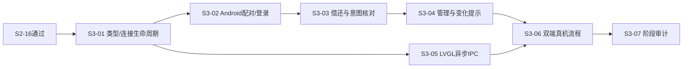

# 阶段 3：Android 与 LVGL 客户端任务卡

状态：设计待执行。没有App、LVGL实现或本阶段验收结果。只落实现有24个公开入口及受限本机RPC；不实现云、蓝牙、iOS、多柜格、第二套后端或手机直接开锁。

## 1. 阶段门槛和分工

阶段入口：**S2-16通过**，且阶段1服务/OpenAPI/IPC已有可重复运行证据。模拟契约可作为客户端测试替身；本阶段最终验收必须注明真实RK/Android/MCU配置，不能把模拟器录像当真机完成。

必读：[阶段0主规格](stage-00-architecture.md)、[客户端内部接口](../architecture/client-interfaces.md)、[API调用链](../architecture/api-links.md)、[OpenAPI](../../contracts/openapi.json)、[私有RPC真源](../../contracts/internal-data-source.json)、[模块所有权](../architecture/module-ownership.md)。所有任务引用同一契约版本和输入文件SHA-256。

一次交给AI一张卡，完成证据审查通过再解锁依赖卡。S3-05可在S3-01通过后独立开发，与Android卡不共改文件；共享契约变更统一交契约负责人，不能互相复制并改字段。阶段3结束后才进入独立监督/故障恢复阶段；本阶段包含真实进度生产，不冒充监督服务已完成。UI/supervisor缺席只告警并使自动恢复不可用，不反向阻断阶段2先行；主机新动作的健康资格仍依据真实Core新鲜度及既有物理/存储等条件。

统一交付：模块README、实际构建/测试命令与环境、输入契约哈希、修改文件清单、正式测试输出索引、未验证项、临时残留检查、脱敏证据。状态写 `PASS / FAIL / NOT_RUN`；无设备/SDK时写NOT_RUN并停在相应验收门槛，不能用“代码生成成功”解锁后续卡。证据存 `docs/evidence/stage-03/<卡ID>/`，文件名不含token/密码/私钥；正式测试和fixture保留。

## S3-01：类型、客户端骨架与依赖边界

- **前置**：S2-16；读完本阶段入口与客户端接口全文。
- **输入**：OpenAPI和RPC真源、目标Android系统版本、RK显示/触摸驱动与ABI记录、既有本机构建接口。仅核对已用库；按[复用依据](../architecture/client-interfaces.md#10-复用与适配依据)选锁定版本，不重建完整开发环境。
- **允许目录**：`app/lib/contracts/`、`app/lib/data/`、`app/lib/core/`、`app/pubspec.yaml`及lock、App最小Android构建/权限配置；`terminal-ui/include/`中的模块私有声明和局部构建入口；对应正式类型/协议测试、模块README与本卡证据。根构建/跨端契约修改交集成负责人。
- **接口与产出**：落实U64Text、ApiResult、CallContext、MutationIntent与typed ApiCall白名单；声明PairingStore/CredentialStore/IntentStore/LockerApi/ClientController及ui_ipc/ui_controller私有头。建立最小可构建页面壳，不做业务页面。客户端DTO从契约生成或集中映射并记录生成/再生办法，不手写另一套枚举。列出依赖来源、精确版本、license、目标SDK、已知公告核对与适配决定。
- **调用链**：测试fixture → DTO严格解析 → typed operationId描述符；无真实借还副作用。用现有样例验证外部包络与RPC status/body映射。
- **异常**：超uint64、UNKNOWN/null、未知状态、响应字段非法、204无正文、旧schema/不兼容契约，均有明确只读错误结果。
- **验收**：全部24公开operationId覆盖，同名23RPC+presence/progress覆盖，WS不出现在service.sock方法里；uint64边界不经浮点；编译/静态分析在实际工具可用时运行并记录。许可/SDK选择有来源，不声称“最新版一定可用”。
- **完成证据**：类型映射表、构建输出、契约fixture结果、版本锁定和许可索引。此卡不凭空填充真机profile。
- **禁止越界**：修改服务器schema/路由、自动重试mutation、业务层重新判断借还、加入云/扫码/蓝牙、多平台依赖。

## S3-02：Android配对、TLS和会话

- **前置**：S3-01；S2-06现场网络准备提供不含私钥的柜体公开配对文件、导出工具与完整指纹来源。该工具必须在本卡实现配对前可用，不能等到阶段5；缺失时提交前置卡补齐。未提供真实证书时只验测试证书，不解锁真机门槛。
- **输入**：PairingStore/CredentialStore/LockerApi规格、当前24入口、目标机证书SAN与局域网地址。先核对锁定Dart/Android版本的TLS与安全存储官方接口。
- **允许目录**：`app/lib/features/pairing/`、`app/lib/features/session/`、`app/lib/data/security/`、`app/lib/data/network/`、配套Android平台安全存储/文档选择配置、本卡正式测试及证据。依赖锁定变更须回S3-01统一复核。
- **接口与产出**：实现公开配对文件导入、完整SHA256/地址/device_id柜前核对页、专用受限SecurityContext、同origin HTTPS/WSS、Keystore凭据隔离、启动/前后台鉴权、退出/忘记配对。密码不落盘，安全存储失败不回退明文。
- **调用链**：本机导出公开材料 → Android文档选择器 → inspectPublicBundle → 柜前核对 → accept/open → login → getCurrentSession/getDevice/getSnapshot → online；恢复登录时不调用不存在的refresh-token接口。
- **异常**：证书替换/过期/SAN错误/错误device_id/不兼容契约/系统时间错误/Keystore失效/401/离线退出/用户被停用。证书变化冻结请求并重新柜前配对，不能关闭校验。模拟器必须明显显示。
- **验收**：未完成带外核对前网络无密码/token；HTTP、HTTPS、WSS的受信范围一致；错误证书与主机名均拒绝且不发凭据；3xx不携带Bearer跳转；token不进入URL、日志、备份或明文文件；退出不取消借还。Android只申请实际必要权限。
- **完成证据**：证书测试矩阵、脱敏抓包/测试服务请求计数、首配与证书变化录屏、实际Android/SDK版本、会话恢复与离线退出测试输出。
- **禁止越界**：匿名配对API、固定默认账号、全局HttpOverrides、无条件badCertificateCallback、云中转、复制私钥到App。

## S3-03：手机借还与响应丢失核对

- **前置**：S3-02通过。
- **输入**：Operation/Tool/Snapshot/Evidence、allowed_actions、当前接口错误语义、MutationIntent与IntentStore、正式借还场景fixture。
- **允许目录**：`app/lib/features/locker/`、`app/lib/features/operations/`、`app/lib/data/intents/`、本人借用/事件展示组件、正式业务交互测试、对应README和本卡证据。
- **接口与产出**：实现refresh、beginBorrowOrReturn、confirm、cancel、reconcilePending；单mutation在途、先持久意图再发、结果待核对页。只显示权威物理/借还状态，断线缓存标过期，不排队离线借还。
- **调用链**：getSnapshot/getTool → createOperation(原tool_revision/原幂等键) → REQUESTED/提示到柜 → GET operation → WAIT_CONFIRM → confirmOperation(原operation_revision/原幂等键) → COMPLETED+GET loans；归还kind=RETURN，手机不调用presence。
- **异常**：双击、超时/RESULT_PENDING、响应丢失、App被杀、进后台、账号切换、409、传感器UNKNOWN、已动作后取消、NO_CHANGE、REVIEW_REQUIRED。已知ID先GET；未知ID仅由用户选择核对后使用原方法/原键/原正文。原用户以外不能读取或恢复该意图；超过30天不自动重发。
- **验收**：重复点击只出现一个用户意图；响应丢失后无新键/新operation；本地取消等待不发送成功取消；201不显示门已开，ACK不显示成功，倒计时归零不改变账本；只有OWNER+服务端allowed_actions显示确认，最终服务端仍鉴权。
- **完成证据**：应用事件轨迹与服务端operation/command对应表、请求数/幂等键脱敏关联、双击/杀进程/丢响应/冲突测试输出、无重复锁动作的服务与设备事实证据。
- **禁止越界**：自动重开、客户端推断成功、把ADMIN当任意用户确认、重连自动发旧POST、手机伪造柜前证明。

## S3-04：管理、变化提示与读取一致性

- **前置**：S3-03通过。
- **输入**：Review/User/CardObservation/CardBinding、WS消息schema、分页和权限规则、已存在LockerApi与前后台生命周期。
- **允许目录**：`app/lib/features/admin/`、`app/lib/features/history/`、`app/lib/data/changes/`、对应controller接线、正式测试、README和本卡证据。不另换网络/TLS实现。
- **接口与产出**：实现listReviews/resolveOperation、用户启停/角色/卡绑定、本人事件/借用分页；统一一个WS订阅和一个10秒前台快照刷新循环，通知合并重查。管理员核验页显示原用户/类型/当前物理/版本及理由，不提供强制完成。createUser密码只在短期内存，持久意图只存原key与username等非敏感定位，不能照普通借还意图保存完整正文。
- **调用链**：WSS resource.changed或resync_required → dirty合并 → GET snapshot/operation/相关列表；ADMIN listReviews → GET operation/当前物理 → resolveOperation；ADMIN listCardObservations → 选择新鲜observation → bindCard。unbindCard保留查询user_revision与幂等键。
- **异常**：WS丢失/重连/溢出、消息乱序、旧GET晚到、页面销毁、后台恢复、卡观察过期/已消费/重复绑定、管理员降权/停用、物理UNKNOWN或核验revision变化。createUser丢响应先listUsers按username核对；确需重发且内存密码已丢失时要求用户重输原密码，保留原key/相同正文，冲突停止核查，不自动换key建重复账号。
- **验收**：WS永不执行命令或直接推进状态；重连与前台恢复重查，暂停后台轮询；不透明cursor原样传递、无跨页越权；旧登录generation与旧资源版本不覆盖新视图；未知物理与原用户不匹配不能核验；Device.ui_restart_count为null时显示“未知”且不自行累计；全部24入口有调用/不适用说明。专门复现createUser提交后丢响应并杀进程：无密码落盘/入日志，重启先listUsers核对，不后台重发；重输原密码只复用原key，错误重输导致IDEMPOTENCY_CONFLICT而不自动换key；账号最多一个。
- **完成证据**：WS断连恢复轨迹、两个GET反序返回测试、管理员/普通用户权限矩阵、卡观察测试、分页与后台网络计数。
- **禁止越界**：手机maintenance/清日志/任意GPIO按钮、给WS加命令、用本地列表缓存判定可借、把管理员账号写死。

## S3-05：LVGL异步IPC与真实循环进度

- **前置**：S3-01通过；使用阶段1真实service.sock协议。supervisor可尚未实现，进度接收端测试必须标为测试替身。
- **输入**：客户端C私有声明、InternalRpcRequest/Response、23同名方法及presence.submit、含sampled_mono_ms的ProgressReport/locker_progress_t、RK显示/触摸ABI与单UI线程约束。所有源采样使用同机CLOCK_MONOTONIC。
- **允许目录**：`terminal-ui/`、对应正式UI/IPC测试、模块README和本卡证据；只使用模块局部构建入口。不得编辑host/ipc、host/domain、host/supervisor来迎合自己的实现。
- **接口与产出**：实现ui_ipc生命周期、copy提交/非阻塞取结果、受限包长/MSG_TRUNC、请求generation、内存token、LVGL所有控件单线程；界面包括登录/总览/当前操作/柜前确认/本人确认/必要管理员核验。只实现当前范围必要页面，用户/卡管理可复用同名RPC的简洁管理员页，不能另建“高级开锁”。
- **调用链**：触摸login/getSnapshot→本人getOperation→presence.submit→Core→异步结果/轮询→WAIT_CONFIRM后confirmOperation。新实例counter为0，登录页完整真实循环后commit_loop_progress产生非零/sample，不等待登录。后台只复制原sample和源age报告，接收方累计now-source_sample一次；IPC/Runtime不能重打时间或先写已累计age造成双算。
- **异常**：服务未启动、socket权限拒绝、包截断/非法JSON、响应丢失/乱序、IPC队列满、UI退出/重启、触摸卡死、显示flush停滞、监督进程未启动。UI断线不自动补发presence，重启回登录页并由原用户重查。
- **验收**：工作线程无LVGL调用；UI没有数据库/UART/GPIO权限；SOCK_SEQPACKET上下限与request_id匹配测试通过；新实例未完成一整轮UI循环时counter为0，登录页真实完整循环即可非零；卡在lv_timer_handler/视图更新时progress/sample时刻不再更新而age增长；IPC积压覆盖传输前等待，重复相同counter不刷新真实进展；源采样字段超uint64/未来/倒退拒绝。独立IPC线程活着不能报告UI继续前进。OBSERVED_RUNNING要求期望新实例非零、至少两次严格递增且源样本新鲜，只证明可交互；登录页可通过，不能因未登录或未取快照而反复重启。业务按钮仍需重新登录+fresh snapshot，不静默复用旧凭据或加匿名接口。supervisor缺席不伪造ACK/恢复成功，不单独阻断依赖真实Core健康的阶段2操作。
- **完成证据**：单线程调用审查、请求/结果队列边界与生命周期测试、SO_PEERCRED拒绝案例、实际RK触摸显示结果、UI卡死与progress采样轨迹。模拟窗口只能证明UI逻辑，不代替RK显示驱动验证。
- **禁止越界**：在UI线程等待IPC、工作线程直接更新控件、定时器自行加健康计数、共享终端永久保存密码/token、给LVGL加入CLI专属maintenance。

## S3-06：双端完整调用链与实物验收

- **前置**：S3-04与S3-05通过，S2-16实物底座仍有效；硬件profile或安装改变须先重验受影响的阶段2门槛。
- **输入**：同一契约版本的服务/固件/App/UI、设备身份与证书、已绑定本人/管理员测试账号、正式验收场景；账号/密码不进入证据仓库。
- **允许目录**：`tests/integration/clients/`、App/UI跨端接线与配置、脱敏正式fixture、模块README和本卡证据。发现Core/UART问题提交最小复现给原模块卡修复，不在客户端补另一套状态机。
- **接口与产出**：固定一个工具、一个合法有效借用；明确标注手机申请→本人到柜→取物关门→本人确认→归还的完整链。编写可复现流程和各段ID关联，触摸与手机显示同一Core结果。
- **调用链**：先用模拟服务跑正式客户端故障fixture，再在局域网真机跑HTTPS/IPC → Core/SQLite → UART → MCU持久化/硬脉冲 → 门/物品事实 → 手机/柜屏重查。simulated=true和实物结果分栏记录。
- **异常**：手机网断、柜屏重启、刷他人卡/旧卡事件、两端同时申请、创建响应丢失、物品没变、未确认超时、门未关、服务/MCU重启、管理核验。独立自动恢复留阶段4，不临时加服务自启来绕过核对。
- **验收**：手机申请不能单独打开柜；本人到柜后仅一条command、物理完成后才可确认；两个端版本与账本一致，读到另一个用户的数据被服务阻止；所有不确定结果有可解释待核对出口；总预算和材料范围不因客户端增加新硬件。
- **完成证据**：真实Android/RK/MCU版本与构建指纹、脱敏ID关联表、双端录像/截图、数据库审计及设备事件索引、每项PASS/FAIL/NOT_RUN矩阵。没有真机证据不写“完整项目可用”。
- **禁止越界**：为了演示写死成功、隐藏simulated、用App动画代替物理证据、改公共契约规避错误、偷偷加入云/新采购。

## S3-07：客户端阶段独立审计与交接门禁

- **前置**：S3-06交付；审查前六卡全部实际结果，不凭其他AI结论复述通过。
- **输入**：前六卡证据、当前输入契约SHA、修改文件/依赖清单、正式测试入口及阶段0禁止事项。
- **允许目录**：正式审计测试、`docs/evidence/stage-03/`和阶段报告。产品缺陷退回责任卡修复并重验受影响项；审计卡不扩大功能或放宽断言。
- **接口与调用链核对**：24公开入口/23同名RPC+presence/progress逐项匹配；TLS带外信任、凭据、幂等持久意图、WS重查、LVGL所有权与真实progress/sample时刻；验证Runtime/IPC只搬运不可变采样、同counter报告不刷新进展。管理员核验只走现有规则；无客户端→锁的旁路。
- **异常复核**：至少独立复现一次证书替换拒绝、原键响应丢失核对、跨用户隔离、旧响应晚到、UI登录页完整循环即可产生非零且业务按钮仍受登录/快照限制、旧实例/单次非零不能判恢复、UI循环卡死而通信线程仍活、presence断线不自动重放。注明测试环境与真机/模拟差异。
- **验收**：契约检查与实际客户端构建/测试通过；相关README/接口/状态文档等于当前事实；无本轮debug print/一次性mock/硬写账号/真实密钥残留；正式诊断日志和fixture保留。存在关键FAIL或NOT_RUN不开放阶段4实物门槛，普通静态检查不能替代。
- **完成证据**：审计报告、精确命令/实际输出索引、未完成项/风险/责任卡、允许进入阶段4或阻断结论。当前设计阶段不预填PASS，不编造专家审核已通过。
- **禁止越界**：将“页面能点击”写成实物成功、只以自测截图解锁阶段、隐藏证据缺口、自动commit/push。
